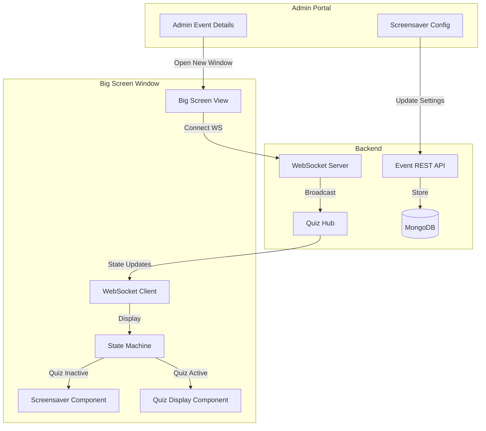

# Big Screen Feature - Implementation Plan

## Overview
Create a separate browser window for big screen display that shows quiz content in fullscreen mode, with screensaver functionality when quiz is not active.

## Architecture



## Todo List

### Phase 1: Backend - Data Model & API

- [ ] **1.1** Extend Event model to include screensaver settings
  - Add `ScreensaverConfig` struct with `ImageID`, `ImageURL` fields
  - Add screensaver field to Event struct

- [ ] **1.2** Add REST API endpoints for screensaver configuration
  - `GET /events/:id/screensaver` - Get screensaver settings
  - `PUT /events/:id/screensaver` - Update screensaver settings
  - Reuse existing media upload infrastructure

### Phase 2: Backend - WebSocket Integration

- [ ] **2.1** Add bigscreen client type to WebSocket hub
  - Add `IsBigScreen` field to Client struct
  - Handle `bigscreen:join` message type
  - Broadcast quiz state to bigscreen clients

- [ ] **2.2** Create new WebSocket message types for bigscreen
  - `bigscreen:join` - Big screen connects to a module
  - Send same messages as host: `cmd:state`, `data:batch`, `sync:minimal`, `state:update`

### Phase 3: Frontend - Big Screen View

- [ ] **3.1** Create BigScreen view component
  - New route: `/bigscreen/:eventId/:moduleId`
  - Connect to WebSocket as bigscreen client
  - Handle state transitions

- [ ] **3.2** Implement BigScreen state machine
  - States: `connecting`, `screensaver`, `lobby`, `get-ready`, `question-active`, `results`, `leaderboard`, `finished`
  - Auto-transition to appropriate state based on quiz state

- [ ] **3.3** Implement quiz display components (reuse from QuizHostScreen)
  - Lobby display with PIN and player list
  - Get ready countdown
  - Question display with timer, answers, histogram
  - Results/Leaderboard display
  - Finished/Podium display

- [ ] **3.4** Implement screensaver component
  - Display configured image
  - Use `object-fit: contain` or `cover` for scaling
  - Add subtle fade-in animation on image load

### Phase 4: Frontend - Admin Integration

- [ ] **4.1** Add "Launch Big Screen" button to AdminEventDetailsScreen
  - Button in module actions area
  - Opens new browser window with BigScreen URL
  - Target: `_blank` for separate window

- [ ] **4.2** Add screensaver configuration UI
  - Section in AdminEventDetailsScreen sidebar
  - Image upload button (reuse ImageUploader component)
  - Preview of current screensaver image
  - Save/Update button

### Phase 5: Robustness & Polish

- [ ] **5.1** Handle WebSocket disconnection gracefully
  - Auto-reconnect logic
  - Show "Reconnecting..." state

- [ ] **5.2** Handle invalid module/event IDs
  - Show error message if module not found
  - Handle case where quiz hasn't been configured

- [ ] **5.3** Preload screensaver image on BigScreen mount
  - Fetch image URL from API
  - Preload before displaying

- [ ] **5.4** Handle quiz reset/end while big screen is showing
  - Transition back to screensaver state when quiz ends

## Implementation Notes

### BigScreen Client WebSocket Flow
1. Connect to WebSocket with moduleId
2. Send `bigscreen:join` message
3. Receive `cmd:state` with current quiz state
4. Receive `data:batch` with questions (if quiz active)
5. Receive real-time updates via `sync:minimal` and `state:update`

### State Transitions
```
screensaver <---> lobby <---> get-ready <---> question-active
                              |                    |
                              v                    v
                         results -------------> leaderboard
                                                        |
                                                        v
                                                     finished
```

### Screensaver Triggers
- Initial state when BigScreen opens (if quiz not active)
- When quiz state becomes "finished"
- When WebSocket disconnects (show screensaver with "Reconnecting..." overlay)

### Image Storage
- Use existing media system (GridFS + /media/upload endpoint)
- Store media ID in Event.ScreensaverConfig.ImageID
- Generate URL via getImageUrl() helper
