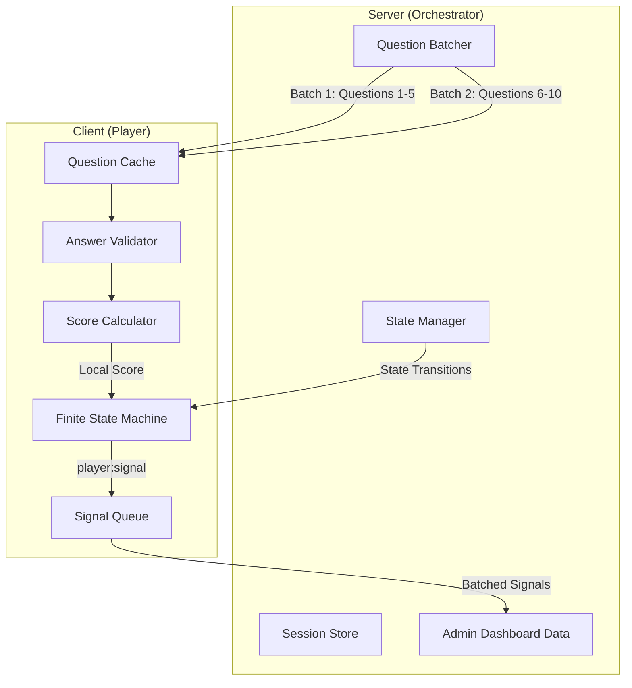
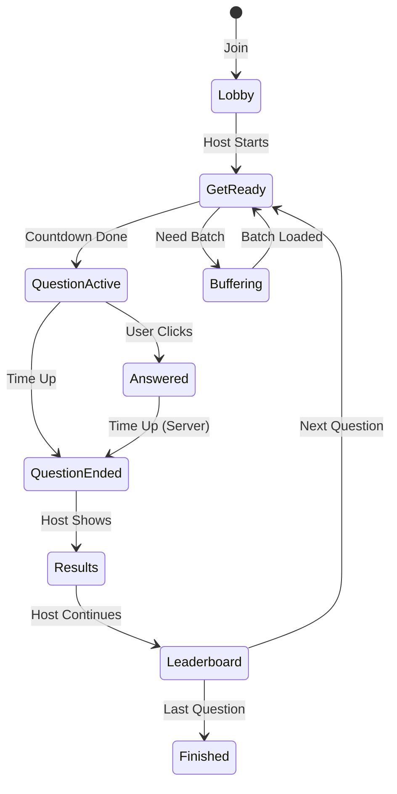

# Client-Side Compute Architecture Plan

## Overview

This document outlines the architecture for shifting compute from the server to the client side for a self-hosted quiz application supporting up to 150 simultaneous users. The goal is to minimize server load while maintaining a responsive user experience.

## Core Principles

1. **Client-Side Validation**: Answer validation and scoring happen on the client
2. **Batch-Based Preloading**: Server distributes questions in ~50KB chunks (batches)
3. **Server Orchestration**: Server controls state transitions and batch distribution
4. **Signal Collection**: Client reports minimal data (answer choice, score earned) for admin statistics

## Current Architecture Analysis

### Existing Flow
```
Client -> Fetch all questions via REST API (on mount)
Client -> WS: player:join
Server -> WS: state:update (full session state)
Client -> WS: player:answer (answerIndex only)
Server -> Validates, scores, broadcasts state:update
```

### Problems with Current Approach
1. All questions fetched upfront (wasteful for large quizzes)
2. Server validates every answer (compute overhead)
3. Server calculates scores (compute overhead)
4. Full session state broadcast on every change (bandwidth overhead)

## Proposed Architecture

### Data Flow Diagram



## 1. Chunked Data Preloading (Batches)

### Batch Structure
- **Target Size**: ~50KB per batch
- **Initial Load**: First question only (for immediate start)
- **Subsequent Loads**: Server-controlled batches
- **Preload Window**: Client always has next 2-3 questions cached

### Batch Content
```go
type QuestionBatch struct {
    BatchIndex    int              `json:"batchIndex"`
    TotalBatches  int              `json:"totalBatches"`
    Questions     []QuizQuestion   `json:"questions"`
    NextBatchAt   int              `json:"nextBatchAt"` // Question index when to request next
}
```

### Server Batching Logic
```go
const TargetBatchSize = 50 * 1024 // 50KB

func CalculateBatches(questions []QuizQuestion) []QuestionBatch {
    // Estimate size per question (text + answers)
    // Average question: ~200-500 bytes
    // Target: ~100-250 questions per batch (well under 50KB)
    // Conservative: 50 questions per batch max
}
```

## 2. Client-Side Answer Validation

### Client Responsibilities
1. **Validate Answer**: Check if selected answer matches `correctIndex`
2. **Calculate Score**: Based on time remaining, streak, etc.
3. **Update Local State**: Track score, streak, rank locally
4. **Report Signal**: Send minimal data to server

### Signal Payload
```typescript
interface PlayerSignal {
    type: 'answer' | 'heartbeat' | 'batch_request';
    payload: {
        questionIndex: number;
        answerIndex: number;
        scoreEarned: number;
        timeSpent: number;      // ms
        timestamp: number;      // client timestamp
    }
}
```

### Server Responsibilities (Minimal)
1. Receive and store signals (for admin stats)
2. Track aggregate answer counts per question
3. Orchestrate state transitions
4. Distribute question batches

## 3. State Orchestration System

### State Types

#### Server-Driven States (Host Controls)
- `lobby` - Waiting for players
- `get-ready` - Countdown before question
- `question-active` - Question is live
- `question-ended` - Time up or all answered
- `results` - Show correct answer
- `leaderboard` - Show standings
- `finished` - Quiz complete

#### Client-Driven States (Local Decisions)
- `answered` - User clicked answer (while timer still running)
- `waiting-others` - Submitted, waiting for time or others
- `buffering` - Loading next batch

### State Transition Diagram



## 4. WebSocket Protocol Updates

### Client -> Server Messages

```typescript
// Join quiz
{ type: 'player:join', payload: { moduleId, nickname } }

// Submit answer (signal)
{ type: 'player:signal', payload: { 
    questionIndex: number, 
    answerIndex: number, 
    scoreEarned: number,
    timeSpent: number 
} }

// Request next batch
{ type: 'player:batch_request', payload: { currentBatchIndex: number } }

// Heartbeat (keepalive + stats)
{ type: 'player:heartbeat', payload: { timestamp: number } }

// Reconnect after inactivity
{ type: 'player:reconnect', payload: {
    moduleId: string,
    nickname: string,
    lastKnownQuestionIndex: number,
    lastKnownState: string
} }
```

### Server -> Client Messages

```typescript
// State transition command
{ type: 'cmd:state', payload: { state: string, data?: any } }

// Question batch delivery
{ type: 'data:batch', payload: QuestionBatch }

// Sync signal (minimal state update)
{ type: 'sync:minimal', payload: {
    questionIndex: number,
    answeredCount: number,
    totalPlayers: number
} }

// Catch-up sync for reconnected users
{ type: 'sync:catchup', payload: {
    currentState: string,
    currentQuestionIndex: number,
    missedQuestions: number[],
    score: number,
    isActive: boolean,
    batchesNeeded: number[]
} }

// Quiz ended (user was inactive too long)
{ type: 'sync:quiz_ended', payload: { reason: string } }

// Quiz complete
{ type: 'cmd:finish', payload: { finalRankings: Player[] } }
```

## 5. Client-Side State Machine

### Implementation (Vue Composable)

```typescript
// composables/useQuizStateMachine.ts
export function useQuizStateMachine() {
    const state = ref<QuizState>('lobby');
    const questionCache = ref<Map<number, QuizQuestion>>(new Map());
    const currentQuestionIndex = ref(0);
    const score = ref(0);
    const streak = ref(0);
    
    // State transitions
    const transitions = {
        'lobby': ['get-ready'],
        'get-ready': ['question-active', 'buffering'],
        'question-active': ['answered', 'question-ended'],
        'answered': ['question-ended'],
        'question-ended': ['results'],
        'results': ['leaderboard'],
        'leaderboard': ['get-ready', 'finished'],
        'buffering': ['get-ready'],
    };
    
    function canTransition(to: QuizState): boolean {
        return transitions[state.value]?.includes(to) ?? false;
    }
    
    function transition(to: QuizState, data?: any) {
        if (!canTransition(to)) {
            console.warn(`Invalid transition: ${state.value} -> ${to}`);
            return;
        }
        
        // Exit current state
        onExitState(state.value);
        
        // Enter new state
        state.value = to;
        onEnterState(to, data);
    }
    
    function onEnterState(newState: QuizState, data?: any) {
        switch (newState) {
            case 'question-active':
                startLocalTimer(data?.timeLimit || 20);
                break;
            case 'answered':
                validateAndScore(data);
                break;
            case 'buffering':
                requestNextBatch();
                break;
        }
    }
    
    return { state, transition, canTransition, questionCache, score };
}
```

## 6. Question Cache Management

### Cache Strategy
```typescript
class QuestionCache {
    private cache = new Map<number, QuizQuestion>();
    private maxCacheSize = 10; // Keep 10 questions max
    
    addBatch(batch: QuestionBatch) {
        batch.questions.forEach((q, idx) => {
            const globalIndex = batch.batchIndex * batchSize + idx;
            this.cache.set(globalIndex, q);
        });
        this.evictOld();
    }
    
    get(index: number): QuizQuestion | undefined {
        return this.cache.get(index);
    }
    
    has(index: number): boolean {
        return this.cache.has(index);
    }
    
    needsBatch(currentIndex: number): boolean {
        // Request next batch when we're 2 questions from end of cache
        const maxCached = Math.max(...this.cache.keys());
        return currentIndex >= maxCached - 2;
    }
    
    private evictOld() {
        // LRU eviction if cache too large
        if (this.cache.size > this.maxCacheSize) {
            const sorted = [...this.cache.entries()].sort((a, b) => a[0] - b[0]);
            const toRemove = sorted.slice(0, sorted.length - this.maxCacheSize);
            toRemove.forEach(([key]) => this.cache.delete(key));
        }
    }
}
```

## 7. Late Response & Reconnection Handling

### Late Response Cutoff Logic

**Client-Side Behavior:**
- Client stops accepting clicks when local timer hits 0
- Score is set to 0 for late/missed questions
- Answer choice is still transmitted for statistics and user feedback

**Server-Side Grace Period:**
```go
const GracePeriodSeconds = 2 // 2-second grace period for network latency

type QuestionWindow struct {
    QuestionIndex int
    StartTime     int64 // Unix timestamp
    EndTime       int64 // When timer expires
    GraceEndTime  int64 // EndTime + GracePeriod
    State         string // "active", "grace", "closed"
}

type AcceptanceResult struct {
    Valid   bool   // Whether to include in statistics
    Scored  bool   // Whether to award points
    Reason  string // "on_time", "grace_period", "too_late"
}

func (qw *QuestionWindow) CanAcceptSignal(signalTime int64) AcceptanceResult {
    if signalTime <= qw.EndTime {
        return AcceptanceResult{Valid: true, Scored: true, Reason: "on_time"}
    }
    if signalTime <= qw.GraceEndTime {
        return AcceptanceResult{Valid: true, Scored: false, Reason: "grace_period"}
    }
    return AcceptanceResult{Valid: false, Scored: false, Reason: "too_late"}
}
```

**Signal Acceptance Results:**
- `Valid: true, Scored: true` - Within time limit, counts for scoring
- `Valid: true, Scored: false` - In grace period, shown in stats but 0 points
- `Valid: false` - Too late, not included in statistics

### User Reconnection & State Sync

**Scenario: User distracted for 5 questions**
When a user reconnects after being inactive:
1. Server detects last question they participated in
2. Server marks missed questions as "skipped" (0 points, answerIndex: -1)
3. Server sends catch-up sync with current state
4. User can continue from current question

**Reconnection Protocol:**
```typescript
// Client sends
interface ReconnectionRequest {
    type: 'player:reconnect';
    payload: {
        moduleId: string;
        nickname: string;
        lastKnownQuestionIndex: number;
        lastKnownState: string;
    }
}

// Server responds
interface ReconnectionResponse {
    type: 'sync:catchup';
    payload: {
        currentState: string;
        currentQuestionIndex: number;
        missedQuestions: number[]; // Questions user missed
        score: number; // Server-tracked score (0 for missed)
        isActive: boolean; // Still in the quiz?
        batchesNeeded: number[]; // Which batches to fetch
    }
}
```

**Server Catch-Up Logic:**
```go
func (h *QuizHub) handleReconnection(client *Client, payload map[string]interface{}) {
    moduleID := payload["moduleId"].(string)
    nickname := payload["nickname"].(string)
    lastKnownIndex := int(payload["lastKnownQuestionIndex"].(float64))
    
    session := h.sessions[moduleID]
    if session == nil {
        client.send <- mustMarshal(ServerMessage{
            Type: "sync:quiz_ended",
            Payload: map[string]interface{}{"reason": "quiz_not_found"},
        })
        return
    }
    
    // Calculate what user missed
    currentIndex := session.CurrentIndex
    missedQuestions := []int{}
    
    for i := lastKnownIndex + 1; i < currentIndex; i++ {
        missedQuestions = append(missedQuestions, i)
        
        // Mark as skipped (0 points, no answer)
        if session.Players[nickname] != nil {
            session.PlayerSignals = append(session.PlayerSignals, PlayerSignal{
                PlayerID:      nickname,
                QuestionIndex: i,
                AnswerIndex:   -1, // -1 = no answer / skipped
                ScoreEarned:   0,
                TimeSpent:     0,
                Timestamp:     time.Now().Unix(),
                Status:        "missed",
            })
        }
    }
    
    // Determine which batches user needs
    batchesNeeded := []int{}
    for batchIdx, batch := range session.Batches {
        // User needs batch if it contains current or future questions
        batchStart := batch.StartIndex
        batchEnd := batch.EndIndex
        
        if (batchStart <= currentIndex && batchEnd >= currentIndex) ||
           (batchStart > currentIndex) {
            batchesNeeded = append(batchesNeeded, batchIdx)
        }
    }
    
    // Check if user is still active (allow up to 5 missed questions)
    isActive := len(missedQuestions) <= 5
    
    client.send <- mustMarshal(ServerMessage{
        Type: "sync:catchup",
        Payload: map[string]interface{}{
            "currentState":           session.State,
            "currentQuestionIndex":   currentIndex,
            "missedQuestions":        missedQuestions,
            "score":                  session.Players[nickname].Score,
            "isActive":               isActive,
            "batchesNeeded":          batchesNeeded,
        },
    })
}
```

### Inactive User Detection

**Rules for Inactive Status:**
- User misses 1-5 questions: Still active, can rejoin
- User misses 6+ questions: Marked as inactive
- Inactive users: Excluded from statistics, final score = 0

**Client Activity Tracking:**
```typescript
class ActivityMonitor {
    private lastActivityTime: number = Date.now();
    private missedQuestions: number = 0;
    private readonly InactivityThreshold = 30000; // 30 seconds
    
    recordActivity() {
        this.lastActivityTime = Date.now();
    }
    
    checkInactivity(): boolean {
        return Date.now() - this.lastActivityTime > this.InactivityThreshold;
    }
    
    markQuestionMissed() {
        this.missedQuestions++;
        if (this.missedQuestions > 5) {
            this.emit('inactive'); // User missed 6+ questions
        }
    }
}
```

**Server Inactive Tracking:**
```go
type PlayerActivity struct {
    LastSignalTime    int64
    QuestionsAnswered int
    QuestionsMissed   int
    IsActive          bool
}

func (pa *PlayerActivity) UpdateActivity(signalTime int64) {
    pa.LastSignalTime = signalTime
    pa.QuestionsAnswered++
}

func (pa *PlayerActivity) MarkMissed() {
    pa.QuestionsMissed++
    if pa.QuestionsMissed > 5 {
        pa.IsActive = false // Mark as inactive after 6 misses
    }
}
```

### Statistics Exclusion Rules

**Active vs Inactive in Stats:**
- **Active players**: Included in all statistics (response times, answer distribution, rankings)
- **Inactive players**:
  - Excluded from answer distribution charts
  - Excluded from response time averages
  - Shown in "inactive" list separately
  - Final score = 0 (if they missed all questions)

```go
func (s *QuizSession) GetActivePlayers() []*Player {
    active := []*Player{}
    for id, player := range s.Players {
        if activity := s.PlayerActivity[id]; activity != nil && activity.IsActive {
            active = append(active, player)
        }
    }
    return active
}

func (s *QuizSession) CalculateAnswerDistribution(questionIndex int) map[int]int {
    distribution := make(map[int]int)
    for _, signal := range s.PlayerSignals {
        // Only include active players who answered on time or in grace period
        if signal.QuestionIndex == questionIndex {
            activity := s.PlayerActivity[signal.PlayerID]
            if activity != nil && activity.IsActive && signal.Status != "missed" {
                distribution[signal.AnswerIndex]++
            }
        }
    }
    return distribution
}
```

## 8. Offline Queue & Sync

### Signal Queue with Timeout Awareness
```typescript
class SignalQueue {
    private queue: PlayerSignal[] = [];
    private isOnline = true;
    private questionWindows = new Map<number, QuestionWindow>();
    
    setQuestionWindow(questionIndex: number, window: QuestionWindow) {
        this.questionWindows.set(questionIndex, window);
    }
    
    enqueue(signal: PlayerSignal) {
        // Check if signal is still valid to send
        const window = this.questionWindows.get(signal.payload.questionIndex);
        if (window && Date.now() > window.graceEndTime) {
            // Too late, don't even queue
            console.log('Signal too late, discarding');
            return;
        }
        
        this.queue.push({
            ...signal,
            payload: {
                ...signal.payload,
                timestamp: Date.now(),
                clientSentAt: Date.now()
            }
        });
        
        if (this.isOnline) {
            this.flush();
        }
    }
    
    async flush() {
        if (this.queue.length === 0) return;
        
        // Filter out signals that are now too old
        const now = Date.now();
        const validSignals = this.queue.filter(s => {
            const window = this.questionWindows.get(s.payload.questionIndex);
            return !window || now <= window.graceEndTime;
        });
        
        // Remove expired signals from queue
        this.queue = this.queue.filter(s => {
            const window = this.questionWindows.get(s.payload.questionIndex);
            return window && now <= window.graceEndTime;
        });
        
        if (validSignals.length === 0) return;
        
        try {
            await quizWS.send('player:signal_batch', { signals: validSignals });
        } catch (err) {
            // Put valid signals back at front of queue
            this.queue.unshift(...validSignals);
            this.isOnline = false;
        }
    }
    
    onReconnect() {
        this.isOnline = true;
        this.flush();
    }
}
```

## 8. Server Implementation Changes

### Simplified Session Model
```go
type QuizSession struct {
    ModuleID        string
    State           string
    CurrentIndex    int
    Players         map[string]*Player
    
    // Minimal tracking
    AnswerCounts    map[int]map[int]int  // questionIndex -> answerIndex -> count
    PlayerSignals   []PlayerSignal       // For admin stats
    
    // Batching
    Batches         []QuestionBatch
    CurrentBatch    int
}

type PlayerSignal struct {
    PlayerID      string    `json:"playerId"`
    QuestionIndex int       `json:"questionIndex"`
    AnswerIndex   int       `json:"answerIndex"`
    ScoreEarned   int       `json:"scoreEarned"`
    TimeSpent     int       `json:"timeSpent"`
    Timestamp     int64     `json:"timestamp"`
}
```

### Hub Message Handlers

```go
// Replace player:answer with player:signal
func (h *QuizHub) handlePlayerSignal(client *Client, payload map[string]interface{}) {
    signal := PlayerSignal{
        PlayerID:      client.PlayerID,
        QuestionIndex: int(payload["questionIndex"].(float64)),
        AnswerIndex:   int(payload["answerIndex"].(float64)),
        ScoreEarned:   int(payload["scoreEarned"].(float64)),
        TimeSpent:     int(payload["timeSpent"].(float64)),
        Timestamp:     time.Now().Unix(),
    }
    
    session := h.sessions[client.ModuleID]
    if session == nil {
        return
    }
    
    // Store signal for admin stats
    session.PlayerSignals = append(session.PlayerSignals, signal)
    
    // Update answer counts
    if session.AnswerCounts[signal.QuestionIndex] == nil {
        session.AnswerCounts[signal.QuestionIndex] = make(map[int]int)
    }
    session.AnswerCounts[signal.QuestionIndex][signal.AnswerIndex]++
    
    // Broadcast minimal sync (answered count only)
    h.broadcastToSessionLocked(client.ModuleID, ServerMessage{
        Type: "sync:minimal",
        Payload: map[string]interface{}{
            "questionIndex": signal.QuestionIndex,
            "answeredCount": len(session.PlayerSignals), // Simplified
        },
    })
}

// Handle batch requests
func (h *QuizHub) handleBatchRequest(client *Client, payload map[string]interface{}) {
    currentBatch := int(payload["currentBatchIndex"].(float64))
    nextBatch := currentBatch + 1
    
    session := h.sessions[client.ModuleID]
    if session == nil || nextBatch >= len(session.Batches) {
        return
    }
    
    client.send <- mustMarshal(ServerMessage{
        Type:    "data:batch",
        Payload: session.Batches[nextBatch],
    })
}
```

## 9. Admin Dashboard Data

### Statistics Collected
```typescript
interface QuizStatistics {
    // Per question
    questionStats: {
        [questionIndex: number]: {
            totalAnswers: number;
            answerDistribution: { [answerIndex: number]: number };
            avgResponseTime: number;
            avgScore: number;
        }
    };
    
    // Per player (aggregated)
    playerStats: {
        [playerId: string]: {
            totalScore: number;
            avgResponseTime: number;
            correctAnswers: number;
        }
    };
    
    // Real-time
    currentState: string;
    activePlayers: number;
    answeredCount: number;
}
```

## 10. Implementation Phases

### Phase 1: Client-Side Validation
- Move answer validation to client
- Client calculates own score
- Send signal to server instead of answer

### Phase 2: Batch Distribution
- Implement server-side batching
- Client requests batches as needed
- Cache management on client

### Phase 3: State Machine Refactor
- Implement client-side state machine
- Server sends state commands, not full state
- Local state transitions for responsive UI

### Phase 4: Signal Queue & Offline Support
- Add signal queuing
- Handle reconnection sync
- Admin statistics aggregation

## 11. Bandwidth Comparison

### Before (Current)
- Initial load: All questions (~500KB for 100 questions)
- Each answer: Full state broadcast (~5KB per answer x 150 players = 750KB)
- Total per question: ~1.25MB

### After (Proposed)
- Initial load: First question only (~5KB)
- Batch loads: 50KB each (every 10-20 questions)
- Each answer: Signal only (~100 bytes x 150 = 15KB)
- State sync: Minimal (~200 bytes)
- Total per question: ~15-20KB (95% reduction)

## 12. Security Considerations

### Trust Model
- Client is trusted for immediate feedback
- Server aggregates signals for statistics
- Host controls all state transitions
- No sensitive data exposed in batches

### Anti-Cheat (Optional Future)
- Server could sample-verify random answers
- Time-based validation (impossible answer times)
- Pattern detection for bot-like behavior
