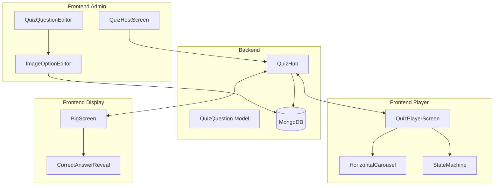
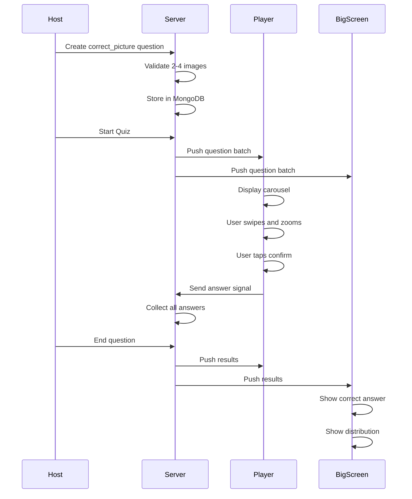

# Correct Picture Question Type - Implementation Plan

## Overview

This plan outlines the implementation of a new question type called **"correct_picture"** (Spot the Real) for the visual trivia platform. Players must identify the correct image from 2-4 visually similar options displayed in a horizontal carousel on mobile devices.

## Key Requirements Summary

| Aspect | Requirement |
|--------|-------------|
| Question Type | `correct_picture` - single choice, correct/wrong scoring only |
| Image Count | 2-4 images per question |
| Image Storage | Pre-uploaded to media library, referenced by ID |
| Visual Effects | White outline/glow effect on images (CSS) |
| Mobile UI | Horizontal snap carousel with zoom capability |
| Selection Flow | Preselect on snap → Confirm button → Submit |
| Admin/BigScreen | Display all images with question text at bottom |
| Results Screen | Show correct answer, desaturate wrong answers, display distribution |

---

## Architecture Diagram



---

## Phase 1: Backend Changes

### 1.1 Update QuizQuestion Model

**File:** [`backend/models/quiz.go`](backend/models/quiz.go)

```go
// Add new field for image options
type QuizQuestion struct {
    ID             string        `json:"id" bson:"id"`
    Type           string        `json:"type" bson:"type"`
    Text           string        `json:"text" bson:"text"`
    Answers        []string      `json:"answers" bson:"answers"`
    CorrectIndex   int           `json:"correctIndex" bson:"correctIndex"`
    CorrectIndices []int         `json:"correctIndices" bson:"correctIndices"`
    CorrectValue   float64       `json:"correctValue" bson:"correctValue"`
    SliderConfig   SliderConfig  `json:"sliderConfig" bson:"sliderConfig"`
    ScoringConfig  ScoringConfig `json:"scoringConfig" bson:"scoringConfig"`
    TimeLimit      int           `json:"timeLimit" bson:"timeLimit"`
    ImageID        *string       `json:"imageId" bson:"imageId"`
    ImageAlt       string        `json:"imageAlt" bson:"imageAlt"`
    // NEW FIELDS for correct_picture
    ImageOptions   []ImageOption `json:"imageOptions" bson:"imageOptions"`
}

// New struct for image options
type ImageOption struct {
    ID     string `json:"id" bson:"id"`           // Unique option ID
    ImageID string `json:"imageId" bson:"imageId"` // Reference to media library
    Label  string `json:"label" bson:"label"`     // Optional label for admin
}
```

### 1.2 Add Question Type Constant

**File:** [`backend/models/quiz.go`](backend/models/quiz.go:39)

```go
const (
    QuestionTypeMultipleChoice  = "multiple_choice"
    QuestionTypeTrueFalse       = "true_false"
    QuestionTypeMultiSelect     = "multi_select"
    QuestionTypeSlider          = "slider"
    QuestionTypeCorrectPicture  = "correct_picture"  // NEW
)
```

### 1.3 Validation Logic

Add validation in handlers to ensure:
- `correct_picture` questions have 2-4 image options
- `correctIndex` is within valid range
- All referenced `imageId` values exist in media library

---

## Phase 2: Frontend Admin Components

### 2.1 Update QuizQuestionEditor

**File:** [`frontend/src/components/QuizQuestionEditor.vue`](frontend/src/components/QuizQuestionEditor.vue)

Changes needed:
1. Add `correct_picture` option to type selector
2. Conditionally show ImageOptionEditor when type is `correct_picture`
3. Hide standard answers grid for this type
4. Add correct index selector for image options

```vue
<select v-model="localQuestion.type" class="select-input" @change="handleTypeChange">
  <option value="multiple_choice">Single Choice</option>
  <option value="multi_select">Multi Select</option>
  <option value="true_false">True / False</option>
  <option value="slider">Slider</option>
  <option value="correct_picture">Correct Picture</option>  <!-- NEW -->
</select>

<!-- NEW: Image Options Editor -->
<div v-if="localQuestion.type === 'correct_picture'" class="image-options-section">
  <ImageOptionEditor
    v-model="localQuestion.imageOptions"
    v-model:correct-index="localQuestion.correctIndex"
    :event-id="eventId"
    :module-id="moduleId"
  />
</div>
```

### 2.2 Create ImageOptionEditor Component

**File:** `frontend/src/components/ImageOptionEditor.vue` (NEW)

Features:
- Display 2-4 image upload slots
- Each slot uses existing ImageUploader component
- Drag-and-drop reordering
- Radio button to select correct answer
- Visual indicator for correct selection
- Add/Remove image buttons

```vue
<template>
  <div class="image-options-editor">
    <div class="options-header">
      <label>Select the correct image (2-4 options)</label>
      <button 
        v-if="imageOptions.length < 4" 
        @click="addOption"
        class="add-option-btn"
      >
        + Add Image
      </button>
    </div>
    
    <div class="image-options-grid">
      <div 
        v-for="(option, idx) in imageOptions" 
        :key="option.id"
        class="image-option-card"
        :class="{ 'is-correct': correctIndex === idx }"
      >
        <div class="option-header">
          <span class="option-number">{{ idx + 1 }}</span>
          <label class="correct-radio">
            <input 
              type="radio" 
              :value="idx" 
              v-model="correctIndex"
              @change="emitUpdate"
            />
            <span class="radio-label">Correct</span>
          </label>
          <button 
            v-if="imageOptions.length > 2" 
            @click="removeOption(idx)"
            class="remove-btn"
          >
            ✕
          </button>
        </div>
        
        <ImageUploader
          v-model="option.imageId"
          :event-id="eventId"
          :module-id="moduleId"
        />
      </div>
    </div>
  </div>
</template>
```

---

## Phase 3: Frontend Player Components

### 3.1 Update QuizPlayerScreen

**File:** [`frontend/src/views/QuizPlayerScreen.vue`](frontend/src/views/QuizPlayerScreen.vue)

Add new template section for `correct_picture` type:

```vue
<!-- CORRECT PICTURE STATE -->
<div 
  v-else-if="state === States.QUESTION_ACTIVE && isCorrectPicture" 
  class="state-container correct-picture-container"
>
  <!-- Header: Question Text (Top 20%) -->
  <div class="question-header-area">
    <div class="question-number-badge">{{ currentQuestionIndex + 1 }}</div>
    <h2 class="question-text">{{ currentQuestion?.text }}</h2>
    <div class="timer-bar">
      <div class="timer-progress" :style="{ width: timerProgress + '%' }"></div>
    </div>
  </div>
  
  <!-- Interactive Zone: Horizontal Carousel (Middle 60%) -->
  <div class="carousel-zone">
    <HorizontalCarousel
      :images="imageOptionUrls"
      :initial-index="preselectedIndex"
      @snap="onCarouselSnap"
      @zoom-change="onZoomChange"
    />
  </div>
  
  <!-- Action Area: Submit Button (Bottom 20%) -->
  <div class="action-area">
    <button 
      class="submit-selection-btn"
      :class="{ 'active': hasPreselection, 'loading': isSubmitting }"
      :disabled="!hasPreselection || hasSubmitted"
      @click="confirmSelection"
    >
      <span v-if="!hasPreselection">Swipe to view options</span>
      <span v-else-if="isSubmitting">
        <span class="spinner"></span>
        Submitting...
      </span>
      <span v-else>Select This Item</span>
    </button>
  </div>
</div>
```

### 3.2 Create HorizontalCarousel Component

**File:** `frontend/src/components/HorizontalCarousel.vue` (NEW)

Features:
- CSS scroll-snap for smooth centering
- Dynamic scaling (center: 100%, sides: 70%)
- Opacity dimming for side items
- Pinch-to-zoom on centered item
- Drop-shadow filter for floating effect
- White outline/glow effect

```vue
<template>
  <div class="carousel-container" ref="containerRef">
    <div class="carousel-track" ref="trackRef">
      <div 
        v-for="(image, idx) in images" 
        :key="idx"
        class="carousel-item"
        :class="{ 
          'is-center': idx === centerIndex,
          'is-side': idx !== centerIndex 
        }"
        :style="getItemStyle(idx)"
        @click="snapToIndex(idx)"
      >
        <div class="image-wrapper" :style="{ transform: zoomScale > 1 ? `scale(${zoomScale})` : '' }">
          
        </div>
      </div>
    </div>
    
    <!-- Navigation dots -->
    <div class="carousel-dots">
      <span 
        v-for="(_, idx) in images" 
        :key="idx"
        class="dot"
        :class="{ 'active': idx === centerIndex }"
        @click="snapToIndex(idx)"
      ></span>
    </div>
  </div>
</template>

<script setup>
import { ref, computed, onMounted, onUnmounted } from 'vue'

const props = defineProps({
  images: { type: Array, required: true },
  initialIndex: { type: Number, default: 0 }
})

const emit = defineEmits(['snap', 'zoom-change'])

const centerIndex = ref(props.initialIndex)
const zoomScale = ref(1)
const trackRef = ref(null)

// CSS for snap scrolling and visual effects
const getItemStyle = (idx) => {
  const isCenter = idx === centerIndex.value
  return {
    transform: isCenter ? 'scale(1)' : 'scale(0.7)',
    opacity: isCenter ? 1 : 0.6,
    filter: isCenter ? 'none' : 'blur(1px)'
  }
}

// Pinch-to-zoom handling
const handlePinchZoom = (e) => {
  // Implementation for touch zoom
}

const snapToIndex = (idx) => {
  centerIndex.value = idx
  emit('snap', idx)
}
</script>

<style scoped>
.carousel-item {
  scroll-snap-align: center;
  transition: transform 0.3s ease, opacity 0.3s ease;
}

.option-image {
  filter: drop-shadow(0 10px 20px rgba(0,0,0,0.3));
  outline: 2px solid rgba(255,255,255,0.8);
  outline-offset: 4px;
  box-shadow: 0 0 20px rgba(255,255,255,0.3);
}
</style>
```

### 3.3 Update State Machine

**File:** [`frontend/src/composables/useQuizStateMachine.js`](frontend/src/composables/useQuizStateMachine.js)

Add handling for `correct_picture` type:
- Add `isCorrectPicture` computed property
- Update scoring logic for correct/wrong only (no time bonus)
- Handle preselection state

---

## Phase 4: Frontend Display Components

### 4.1 Update BigScreen Layout

**File:** [`frontend/src/views/BigScreen.vue`](frontend/src/views/BigScreen.vue)

For `correct_picture` questions, invert the layout:
- Images displayed prominently at top
- Question text at bottom

```vue
<!-- CORRECT PICTURE QUESTION STATE -->
<div v-else-if="gameState === 'question-active' && isCorrectPicture" class="state-container correct-picture-container">
  <div class="timer-header">
    <div class="timer" :class="{ 'timer-low': timeRemaining <= 5 }">
      {{ timeRemaining }}
    </div>
    <div class="question-counter">{{ currentQuestionIndex + 1 }} / {{ totalQuestions }}</div>
  </div>
  
  <!-- Images Grid (Top) -->
  <div class="images-display-grid">
    <div 
      v-for="(option, idx) in currentQuestion?.imageOptions" 
      :key="idx"
      class="display-image-card"
    >
      
      <span class="image-number">{{ idx + 1 }}</span>
    </div>
  </div>
  
  <!-- Question Text (Bottom) -->
  <div class="question-text-bottom">
    <h2>{{ currentQuestion?.text }}</h2>
  </div>
</div>
```

### 4.2 Create Correct Answer Reveal Screen

This screen shows after each `correct_picture` question:
- All images displayed
- Correct answer highlighted
- Wrong answers desaturated
- Answer distribution counts under each image

```vue
<!-- CORRECT PICTURE RESULTS -->
<div v-else-if="gameState === 'results' && isCorrectPicture" class="state-container correct-picture-results">
  <div class="results-header">
    <h1>Results</h1>
    <div class="timer">{{ timeRemaining }}</div>
  </div>
  
  <div class="results-images-grid">
    <div 
      v-for="(option, idx) in currentQuestion?.imageOptions" 
      :key="idx"
      class="result-image-card"
      :class="{ 
        'is-correct': idx === currentQuestion?.correctIndex,
        'is-wrong': idx !== currentQuestion?.correctIndex 
      }"
    >
      
      <div class="answer-count">
        <span class="count-number">{{ getAnswerCount(idx) }}</span>
        <span class="count-label">answers</span>
      </div>
      <div v-if="idx === currentQuestion?.correctIndex" class="correct-badge">
        ✓ Correct
      </div>
    </div>
  </div>
  
  <div class="question-text-bottom">
    <h2>{{ currentQuestion?.text }}</h2>
  </div>
</div>

<style scoped>
.result-image-card.is-wrong img {
  filter: grayscale(80%) opacity(0.6);
}

.result-image-card.is-correct img {
  box-shadow: 0 0 30px rgba(76, 175, 80, 0.6);
  border: 3px solid #4CAF50;
}
</style>
```

---

## Phase 5: QuizHostScreen Updates

### 5.1 Update Host Controls

**File:** [`frontend/src/views/QuizHostScreen.vue`](frontend/src/views/QuizHostScreen.vue)

Add preview and controls for `correct_picture`:
- Show all images in preview
- Highlight correct answer for host
- Same results view as BigScreen

---

## Data Flow Diagram



---

## Implementation Order

1. **Backend Model Updates** - Add new fields and constants
2. **ImageOptionEditor Component** - Admin can create questions
3. **QuizQuestionEditor Updates** - Integrate new type
4. **HorizontalCarousel Component** - Core mobile interaction
5. **QuizPlayerScreen Updates** - Player can answer
6. **BigScreen Layout Updates** - Display for audience
7. **Results/Reveal Screen** - Show correct answer
8. **QuizHostScreen Updates** - Host controls
9. **End-to-end Testing** - Verify complete flow

---

## Technical Considerations

### Image Loading Strategy
- Pre-fetch all option images when question batch arrives
- Use `loading="eager"` for carousel images
- Show placeholder during load

### Carousel Performance
- Use CSS `scroll-snap-type: x mandatory` for native feel
- Use `IntersectionObserver` for center detection
- Debounce zoom events

### Accessibility
- Add ARIA labels for carousel navigation
- Keyboard navigation support (arrow keys)
- Screen reader announcements for selection

### Responsive Design
- Mobile-first carousel design
- Tablet: Show 2 images side-by-side
- Desktop BigScreen: Grid layout for all images

---

## Files to Create/Modify Summary

| File | Action | Description |
|------|--------|-------------|
| `backend/models/quiz.go` | Modify | Add ImageOption struct and type constant |
| `frontend/src/components/ImageOptionEditor.vue` | Create | Admin image options editor |
| `frontend/src/components/HorizontalCarousel.vue` | Create | Mobile carousel component |
| `frontend/src/components/QuizQuestionEditor.vue` | Modify | Add correct_picture type support |
| `frontend/src/views/QuizPlayerScreen.vue` | Modify | Add carousel UI section |
| `frontend/src/views/BigScreen.vue` | Modify | Add correct_picture layout |
| `frontend/src/views/QuizHostScreen.vue` | Modify | Add preview and controls |
| `frontend/src/composables/useQuizStateMachine.js` | Modify | Add correct_picture handling |

---

## Questions Resolved

1. ✅ Question type: New type within existing quiz system
2. ✅ Image count: 2-4 images per question
3. ✅ Image storage: Pre-uploaded to media library
4. ✅ Visual effects: CSS-based white outline/glow
5. ✅ Selection flow: Preselect → Confirm button → Submit
6. ✅ Scoring: Correct/wrong only, no time bonus
