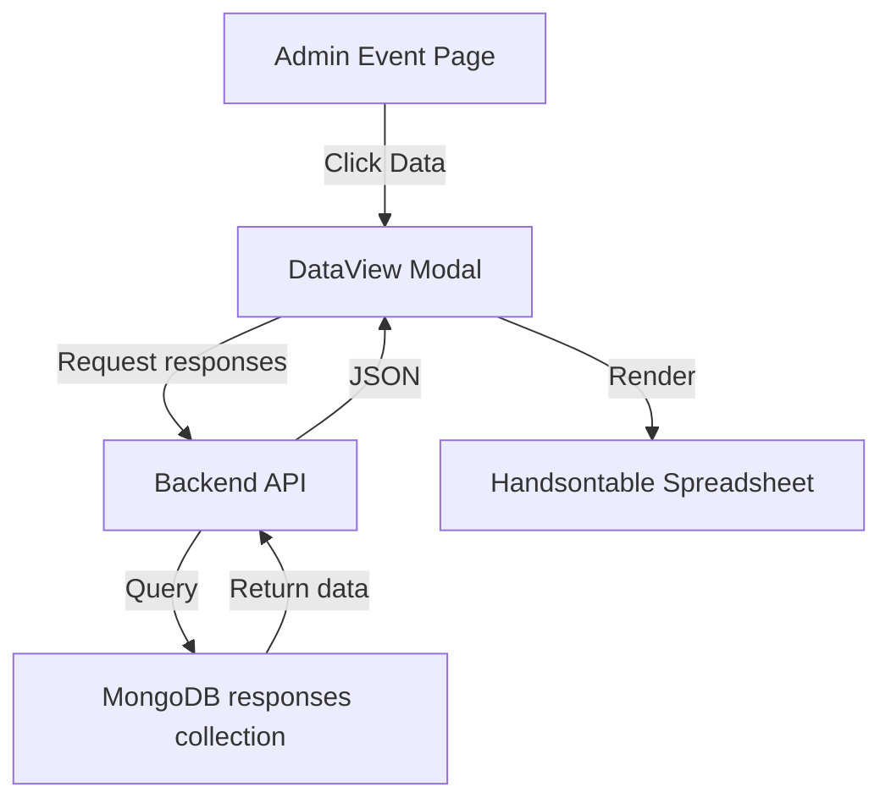

# DataView Implementation Plan

## Overview
Add a new "DataView" feature to the Admin Event page that displays module-generated data in a spreadsheet-like view using Handsontable.

## Architecture



## Requirements Summary
- **Spreadsheet Library**: Handsontable Community Edition (free)
- **Data Source**: MongoDB `responses` collection
- **Display**: Each module has its own "Data" tab/button
- **Debug**: Use Go `//go:build debug` tag for logging

---

## Implementation Steps

### 1. Backend: Add API Endpoint
Create a new endpoint to fetch responses for a specific module:
- **Endpoint**: `GET /events/{eventId}/modules/{moduleId}/responses`
- **Query MongoDB**: Filter responses by `eventId` and `moduleId`
- **Return**: JSON array of responses with all fields

### 2. Backend: Add Debug Logging
Add debug logging using the existing `//go:build debug` pattern:
- Create debug statements in the new handler
- Log query parameters and response counts

### 3. Frontend: Install Handsontable
Add dependency to `frontend/package.json`:
```json
"@handsontable/vue3": "^latest",
"handsontable": "^latest"
```

### 4. Frontend: Create DataView Component
Create `frontend/src/components/DataView.vue`:
- Accept `eventId` and `moduleId` as props
- Fetch responses from backend API
- Transform data into table format for Handsontable
- Display in spreadsheet view with:
  - Column headers from response data keys
  - All rows of data
  - Read-only mode (default)

### 5. Frontend: Add Data Button to Modules
Modify `AdminEventDetailsScreen.vue`:
- Add "Data" button to each module in the module list
- Clicking opens the DataView modal

### 6. Frontend: Integrate Modal
- Add modal overlay for DataView
- Pass selected module info to DataView component
- Handle modal close

---

## Data Flow

### API Response Structure
```json
{
  "responses": [
    {
      "_id": "...",
      "eventId": "123456",
      "moduleId": "654321",
      "userId": "user123",
      "data": {
        "field1": "value1",
        "field2": "value2"
      },
      "createdAt": "2024-01-01T00:00:00Z"
    }
  ]
}
```

### Handsontable Data Format
```javascript
[
  ["userId", "field1", "field2", "createdAt"],
  ["user123", "value1", "value2", "2024-01-01"]
]
```

---

## File Changes Summary

| File | Action |
|------|--------|
| `backend/handlers/events.go` | Add GetModuleResponses handler |
| `backend/main.go` | Register new route |
| `frontend/package.json` | Add Handsontable dependencies |
| `frontend/src/components/DataView.vue` | Create new component |
| `frontend/src/views/AdminEventDetailsScreen.vue` | Add Data button and modal |

---

## Debug Logging Pattern

Use existing pattern from project:
```go
//go:build debug

func DebugLog(format string, args ...interface{}) {
    log.Printf("[DEBUG] "+format, args...)
}
```

---

## Considerations

1. **Handsontable License**: Use Community Edition (free) - no license key required
2. **Data Structure**: Responses have flexible `data` map - need to dynamically extract keys for columns
3. **Read-only**: Default to read-only mode for admin viewing
4. **Empty State**: Handle case when no responses exist
5. **Large Data**: Consider pagination if many responses

---

## Next Steps
Once approved, proceed with implementation starting with backend API endpoint.
