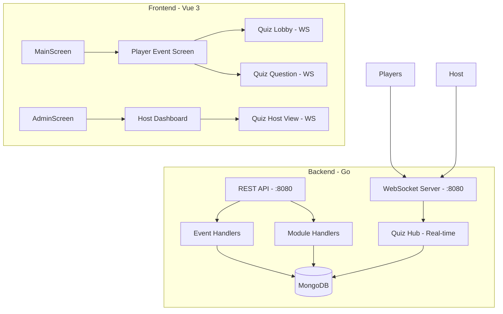

# Kahoot Clone Implementation Plan

## Overview
Build a real-time quiz platform with WebSocket support alongside the existing form module system.

## Current State Analysis

### Existing Architecture
- **Backend**: Go with MongoDB, REST API for events/modules
- **Frontend**: Vue 3 + Vite, dark theme UI
- **Real-time**: HTTP polling (3-second intervals)
- **Module Types**: `form` (already implemented)

### Key Gaps
1. No WebSocket infrastructure for real-time gameplay
2. No quiz-specific module type
3. No player nickname flow
4. No timer/question state management
5. No scoring/leaderboard system

---

## Architecture



---

## Implementation Plan

### Phase 1: Backend Foundation

#### 1.1 Add WebSocket Support to Go Backend
- [ ] Add `gorilla/websocket` package dependency
- [ ] Create `backend/hub/quiz_hub.go` - manages WebSocket connections
- [ ] Create `backend/hub/client.go` - client representation
- [ ] Create `backend/hub/types.go` - message type definitions
- [ ] Update `main.go` to serve WebSocket endpoint at `/ws`

**Message Types:**
```go
// Client -> Server
type ClientMessage struct {
    Type    string      `json:"type"`
    Payload interface{} `json:"payload"`
}

// Server -> Client
type ServerMessage struct {
    Type    string      `json:"type"`
    Payload interface{} `json:"payload"`
}
```

#### 1.2 Add Quiz Data Models
- [ ] Update `backend/models/event.go` to include quiz-specific fields
- [ ] Create `backend/models/quiz.go`

```go
// Question model
type QuizQuestion struct {
    ID           string   `json:"id" bson:"id"`
    Text         string   `json:"text" bson:"text"`
    Answers      []string `json:"answers" bson:"answers"`      // 4 answer options
    CorrectIndex int      `json:"correctIndex" bson:"correctIndex"`
    TimeLimit    int      `json:"timeLimit" bson:"timeLimit"` // seconds
}

// Quiz module data
type QuizModuleData struct {
    Questions []QuizQuestion `json:"questions" bson:"questions"`
}

// Quiz state
type QuizSession struct {
    EventID      string              `json:"eventId"`
    ModuleID     string              `json:"moduleId"`
    CurrentIndex int                 `json:"currentIndex"`
    State        string              `json:"state"` // "lobby", "question", "results", "finished"
    Players      map[string]*Player  `json:"players"`
    Answers      map[string]string   `json:"answers"` // playerID -> answerIndex
}

// Player in quiz
type Player struct {
    ID       string `json:"id"`
    Nickname string `json:"nickname"`
    Score    int    `json:"score"`
}
```

#### 1.3 Add Quiz REST API Endpoints
- [ ] `POST /events/{eventID}/modules/quiz` - Create quiz module
- [ ] `PUT /events/{eventID}/modules/{moduleID}/quiz/questions` - Add questions
- [ ] `GET /events/{eventID}/modules/{moduleID}/quiz/state` - Get current state
- [ ] `POST /events/{eventID}/modules/{moduleID}/quiz/start` - Start quiz
- [ ] `POST /events/{eventID}/modules/{moduleID}/quiz/next` - Next question
- [ ] `GET /events/{eventID}/modules/{moduleID}/quiz/results` - Get final results

#### 1.4 Add Quiz WebSocket Events
- [ ] `player:join` - Player joins quiz lobby
- [ ] `player:answer` - Player submits answer
- [ ] `host:start_quiz` - Host starts quiz
- [ ] `host:next_question` - Host moves to next question
- [ ] `host:end_quiz` - Host ends quiz
- [ ] `state:update` - Broadcast state changes
- [ ] `question:start` - New question with timer
- [ ] `question:end` - Time's up
- [ ] `answer:reveal` - Show correct answer
- [ ] `leaderboard` - Updated scores

---

### Phase 2: Frontend Quiz Module

#### 2.1 Add Quiz Configuration Component
- [ ] Create `frontend/src/components/QuizModuleConfig.vue`
- [ ] Create `frontend/src/components/QuizQuestionEditor.vue`
- [ ] Allow adding/editing questions with 4 answers each
- [ ] Set time limit per question (default 20 seconds)
- [ ] Mark correct answer

#### 2.2 Add Quiz Host Screen
- [ ] Create `frontend/src/views/QuizHostScreen.vue`
- [ ] Show lobby with connected players
- [ ] "Start Quiz" button
- [ ] Real-time question display for host
- [ ] Show answer statistics (how many chose each option)
- [ ] Leaderboard display
- [ ] Controls: Next Question, End Quiz

#### 2.3 Add Quiz Player Screen
- [ ] Create `frontend/src/views/QuizPlayerScreen.vue`
- [ ] Lobby screen - enter nickname
- [ ] Waiting screen - "Get ready for question X"
- [ ] Question screen - 4 answer buttons
- [ ] Timer countdown
- [ ] Answer submitted confirmation
- [ ] Result screen - correct/incorrect, points earned
- [ ] Final leaderboard

#### 2.4 Update Router
- [ ] Add route `/quiz/:eventId/:moduleId/host`
- [ ] Add route `/quiz/:eventId/:moduleId/player`
- [ ] Update `AdminEventDetailsScreen` to navigate to quiz host
- [ ] Update `EventScreen` to show quiz option

#### 2.5 WebSocket Client Service
- [ ] Create `frontend/src/services/websocket.js`
- [ ] Connect to WebSocket server
- [ ] Handle reconnection
- [ ] Event-based messaging

---

### Phase 3: Quiz Gameplay Flow

#### 3.1 Lobby Phase
1. Host opens quiz module → redirect to `/quiz/:eventId/:moduleId/host`
2. Players join via PIN → redirect to `/quiz/:eventId/:moduleId/player`
3. Players enter nickname
4. Host sees live player count
5. Host clicks "Start Quiz"

#### 3.2 Question Phase
1. All players see "Question X coming up..."
2. Timer starts (configurable, default 20s)
3. Players tap answer buttons
4. Host sees real-time answer counts
5. Timer ends → "Time's up!"

#### 3.3 Answer Reveal Phase
1. Show correct answer highlight
2. Players see if they were correct
3. Calculate points: base points + speed bonus
4. Update leaderboard

#### 3.4 Results Phase
1. Show final scores
2. Option to review question answers
3. Host can start next question or end quiz

---

### Phase 4: Scoring System

#### Points Calculation
```javascript
// Base points: 1000 per correct answer
// Speed bonus: max 500, based on time remaining
// Formula: 1000 + (500 * timeRemaining / timeLimit)

Example:
- 20 second question
- Answer at 5 seconds remaining = 75% time used
- Bonus: 500 * 0.75 = 375
- Total: 1000 + 375 = 1375 points
```

#### 4.1 Implement Scoring in Backend
- [ ] Calculate points when answer submitted
- [ ] Track per-player scores
- [ ] Update leaderboard on each answer

---

## File Changes Summary

### New Backend Files
```
backend/
├── hub/
│   ├── quiz_hub.go      # WebSocket hub
│   ├── client.go        # Client representation
│   └── types.go         # Message types
├── models/
│   └── quiz.go          # Quiz models
└── handlers/
    └── quiz.go          # Quiz HTTP handlers
```

### New Frontend Files
```
frontend/src/
├── components/
│   ├── QuizModuleConfig.vue      # Admin config UI
│   └── QuizQuestionEditor.vue    # Question editor
├── views/
│   ├── QuizHostScreen.vue        # Host dashboard
│   └── QuizPlayerScreen.vue      # Player experience
├── services/
│   └── websocket.js              # WebSocket client
└── router/
    └── index.js                  # Add quiz routes
```

### Modified Files
- `backend/models/event.go` - Add quiz module support
- `backend/main.go` - Add WebSocket endpoint
- `frontend/src/views/AdminEventDetailsScreen.vue` - Quiz module option
- `frontend/src/views/EventScreen.vue` - Quiz module navigation

---

## Docker Changes

Update `docker-compose.yml`:
- WebSocket port (same as HTTP, 8080)
- CORS configuration for WebSocket

---

## Testing Checklist

- [ ] Multiple players can join simultaneously
- [ ] Timer syncs across all clients
- [ ] Answers submit in real-time
- [ ] Leaderboard updates correctly
- [ ] Host controls work (start, next, end)
- [ ] Reconnection handles disconnects
- [ ] Scoring calculations are accurate

---

## Future Enhancements (Phase 2)
- Question types: True/False, Multiple Select
- Sound effects and animations
- Player avatars
- Question templates
- Export results to CSV
- Power-ups (double points, steal points)
