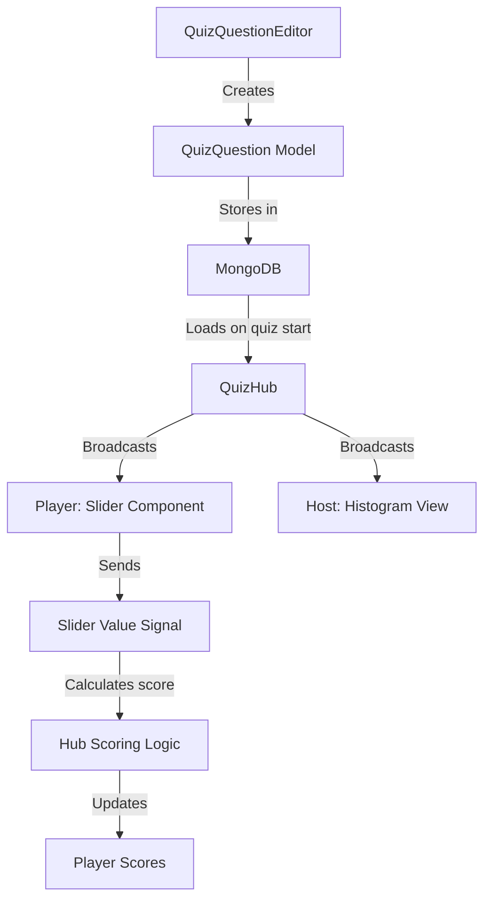

# Slider Question Type Implementation Plan

## Overview

This document outlines the implementation plan for a new **Slider Question Type** (inspired by "Price is Right") for the Quia quiz platform.

### Example Use Case
**Question**: "What is the percentage of water in the human body?"
- Slider range: 0% to 100%
- Correct answer: ~60%
- User drags slider to their estimate and releases to submit

---

## 1. Architecture Overview



---

## 2. Data Model Changes

### 2.1 Updated QuizQuestion Model

**File**: [`backend/models/quiz.go`](../backend/models/quiz.go)

```go
// Extended question types
const (
    QuestionTypeMultipleChoice = "multiple_choice"
    QuestionTypeTrueFalse     = "true_false"
    QuestionTypeSlider        = "slider"  // NEW
)

// SliderConfig stores slider-specific configuration
type SliderConfig struct {
    MinValue      float64 `json:"minValue"`       // Minimum value on slider
    MaxValue      float64 `json:"maxValue"`       // Maximum value on slider
    Step          float64 `json:"step"`           // Step size (0 for continuous)
    DecimalPlaces int     `json:"decimalPlaces"`  // Display decimals (0-4)
    Unit          string  `json:"unit"`            // Unit label (%, $, years, etc.)
}

// ScoringConfig stores scoring rules
type ScoringConfig struct {
    Mode           string  `json:"mode"`            // "symmetric" or "asymmetric"
    MaxPoints      int     `json:"maxPoints"`       // Points for exact answer
    Tolerance      float64 `json:"tolerance"`        // Distance for partial credit
    PartialPercent float64 `json:"partialPercent"`  // % of max points at tolerance edge
}

// Updated QuizQuestion struct
type QuizQuestion struct {
    ID            string        `json:"id" bson:"id"`
    Type          string        `json:"type" bson:"type"`
    Text          string        `json:"text" bson:"text"`
    Answers       []string      `json:"answers" bson:"answers"` // Not used for slider
    CorrectIndex  int           `json:"correctIndex" bson:"correctIndex"` // Slider: correct value
    CorrectValue  float64       `json:"correctValue" bson:"correctValue"` // NEW: exact answer
    SliderConfig  SliderConfig `json:"sliderConfig" bson:"sliderConfig"` // NEW
    ScoringConfig ScoringConfig `json:"scoringConfig" bson:"scoringConfig"` // NEW
    TimeLimit     int           `json:"timeLimit" bson:"timeLimit"` // seconds
}
```

### 2.2 Updated PlayerSignal

**File**: [`backend/models/quiz.go`](../backend/models/quiz.go)

```go
// PlayerSignal represents a player's answer signal with metadata
type PlayerSignal struct {
    PlayerID      string  `json:"playerId" bson:"playerId"`
    QuestionIndex int     `json:"questionIndex" bson:"questionIndex"`
    AnswerIndex   int     `json:"answerIndex" bson:"answerIndex"` // Still used for MC/TF
    AnswerValue   float64 `json:"answerValue" bson:"answerValue"`  // NEW: for slider
    ScoreEarned   int     `json:"scoreEarned" bson:"scoreEarned"`
    TimeSpent     int     `json:"timeSpent" bson:"timeSpent"` // ms
    Timestamp     int64   `json:"timestamp" bson:"timestamp"`
    Status        string  `json:"status" bson:"status"` // "on_time", "grace_period", "missed"
}
```

---

## 3. Scoring Logic

### 3.1 Symmetric Scoring (Both Sides)

For questions where both over and under estimates are accepted:

```
distance = |userValue - correctValue|
score = maxPoints * max(0, 1 - (distance / tolerance))
```

**Example**:
- Correct: 60
- Tolerance: 20
- Max Points: 1000
- User: 55 → distance=5 → score = 1000 * (1 - 5/20) = 750
- User: 80 → distance=20 → score = 1000 * (1 - 20/20) = 0

### 3.2 Asymmetric Scoring (Like Price is Right)

For questions where going over is penalized (zero points):

```
if mode == "asymmetric" {
    if userValue > correctValue {
        score = 0
    } else {
        distance = correctValue - userValue
        score = maxPoints * max(0, 1 - (distance / tolerance))
    }
}
```

---

## 4. Frontend Components

### 4.1 Slider Question Editor

**File**: [`frontend/src/components/QuizQuestionEditor.vue`](../frontend/src/components/QuizQuestionEditor.vue)

**New UI Elements**:
```vue
<template>
  <!-- Existing code... -->
  
  <!-- Slider-specific configuration (shown when type === 'slider') -->
  <div v-if="localQuestion.type === 'slider'" class="slider-config">
    <div class="config-section">
      <h4>Slider Scale</h4>
      <div class="input-row">
        <div class="input-group">
          <label>Min Value</label>
          <input type="number" v-model.number="localQuestion.sliderConfig.minValue" />
        </div>
        <div class="input-group">
          <label>Max Value</label>
          <input type="number" v-model.number="localQuestion.sliderConfig.maxValue" />
        </div>
      </div>
      
      <div class="input-row">
        <div class="input-group">
          <label>Correct Answer</label>
          <input type="number" v-model.number="localQuestion.correctValue" />
        </div>
        <div class="input-group">
          <label>Unit Label</label>
          <input type="text" v-model="localQuestion.sliderConfig.unit" placeholder="%" />
        </div>
      </div>
    </div>
    
    <div class="config-section">
      <h4>Step Size</h4>
      <div class="input-row">
        <div class="input-group">
          <label>Step</label>
          <input type="number" v-model.number="localQuestion.sliderConfig.step" min="0" />
          <small>Use 0 for continuous values</small>
        </div>
        <div class="input-group">
          <label>Decimal Places</label>
          <select v-model.number="localQuestion.sliderConfig.decimalPlaces">
            <option :value="0">0 (whole numbers)</option>
            <option :value="1">1 decimal</option>
            <option :value="2">2 decimals</option>
            <option :value="3">3 decimals</option>
            <option :value="4">4 decimals</option>
          </select>
        </div>
      </div>
    </div>
    
    <div class="config-section">
      <h4>Scoring</h4>
      <div class="input-group">
        <label>Scoring Mode</label>
        <select v-model="localQuestion.scoringConfig.mode">
          <option value="symmetric">Symmetric (both sides accepted)</option>
          <option value="asymmetric">Asymmetric (no overbidding)</option>
        </select>
      </div>
      
      <div class="input-row">
        <div class="input-group">
          <label>Max Points</label>
          <input type="number" v-model.number="localQuestion.scoringConfig.maxPoints" />
        </div>
        <div class="input-group">
          <label>Tolerance (±)</label>
          <input type="number" v-model.number="localQuestion.scoringConfig.tolerance" />
        </div>
      </div>
    </div>
    
    <!-- Preview Slider -->
    <div class="slider-preview">
      <SliderComponent
        :min="localQuestion.sliderConfig.minValue"
        :max="localQuestion.sliderConfig.maxValue"
        :step="localQuestion.sliderConfig.step"
        :unit="localQuestion.sliderConfig.unit"
        :decimalPlaces="localQuestion.sliderConfig.decimalPlaces"
        :readonly="true"
      />
    </div>
  </div>
</template>
```

### 4.2 Slider Player Component

**New File**: [`frontend/src/components/SliderComponent.vue`](../frontend/src/components/SliderComponent.vue)

```vue
<template>
  <div 
    class="slider-component"
    :class="{ 'vertical': orientation === 'vertical', 'horizontal': orientation === 'horizontal' }"
    ref="sliderContainer"
  >
    <!-- Track -->
    <div class="slider-track" ref="track">
      <!-- Filled portion (from min to current value) -->
      <div 
        class="slider-fill"
        :style="{ [fillProperty]: fillPercentage + '%' }"
      ></div>
      
      <!-- Correct answer marker (shown in results) -->
      <div 
        v-if="showCorrectMarker && correctValue !== null"
        class="correct-marker"
        :style="{ [fillProperty]: correctPercentage + '%' }"
      >
        <span class="marker-label">{{ correctValue }}{{ unit }}</span>
      </div>
    </div>
    
    <!-- Thumb -->
    <div 
      class="slider-thumb"
      :style="{ [fillProperty]: fillPercentage + '%' }"
      :class="{ 'dragging': isDragging }"
    >
      <span class="thumb-value">{{ formattedValue }}</span>
    </div>
    
    <!-- Min/Max Labels -->
    <div class="slider-labels">
      <span class="min-label">{{ formattedMin }}{{ unit }}</span>
      <span class="max-label">{{ formattedMax }}{{ unit }}</span>
    </div>
  </div>
</template>

<script setup>
import { ref, computed, onMounted, onUnmounted } from 'vue'

const props = defineProps({
  min: { type: Number, default: 0 },
  max: { type: Number, default: 100 },
  step: { type: Number, default: 1 },
  modelValue: { type: Number, default: 50 },
  unit: { type: String, default: '' },
  decimalPlaces: { type: Number, default: 0 },
  orientation: { type: String, default: 'horizontal' }, // 'horizontal' | 'vertical'
  readonly: { type: Boolean, default: false },
  showCorrectMarker: { type: Boolean, default: false },
  correctValue: { type: Number, default: null }
})

const emit = defineEmits(['update:modelValue', 'change', 'drag-start', 'drag-end'])

const sliderContainer = ref(null)
const track = ref(null)
const isDragging = ref(false)

const fillPercentage = computed(() => {
  const range = props.max - props.min
  return ((props.modelValue - props.min) / range) * 100
})

const correctPercentage = computed(() => {
  if (props.correctValue === null) return 0
  const range = props.max - props.min
  return ((props.correctValue - props.min) / range) * 100
})

const fillProperty = computed(() => {
  return props.orientation === 'vertical' ? 'bottom' : 'left'
})

const formattedValue = computed(() => {
  return props.modelValue.toFixed(props.decimalPlaces)
})

const formattedMin = computed(() => {
  return props.min.toFixed(props.decimalPlaces)
})

const formattedMax = computed(() => {
  return props.max.toFixed(props.decimalPlaces)
})

// Touch/Mouse handling
const handleStart = (event) => {
  if (props.readonly) return
  isDragging.value = true
  emit('drag-start')
  updateValue(event)
  document.addEventListener('mousemove', handleMove)
  document.addEventListener('mouseup', handleEnd)
  document.addEventListener('touchmove', handleMove)
  document.addEventListener('touchend', handleEnd)
}

const handleMove = (event) => {
  if (!isDragging.value) return
  updateValue(event)
}

const handleEnd = () => {
  if (!isDragging.value) return
  isDragging.value = false
  emit('drag-end')
  emit('change', props.modelValue)
  document.removeEventListener('mousemove', handleMove)
  document.removeEventListener('mouseup', handleEnd)
  document.removeEventListener('touchmove', handleMove)
  document.removeEventListener('touchend', handleEnd)
}

const updateValue = (event) => {
  if (!track.value) return
  
  const rect = track.value.getBoundingClientRect()
  const clientX = event.touches ? event.touches[0].clientX : event.clientX
  const clientY = event.touches ? event.touches[0].clientY : event.clientY
  
  let position
  if (props.orientation === 'vertical') {
    position = props.orientation === 'vertical' 
      ? (rect.bottom - (props.orientation === 'vertical' ? clientY : clientY))
      : (clientX - rect.left)
    position = Math.max(0, Math.min(1, (rect.bottom - clientY) / rect.height))
  } else {
    position = (clientX - rect.left) / rect.width
  }
  
  let value = props.min + (position * (props.max - props.min))
  
  // Apply step if specified
  if (props.step > 0) {
    value = Math.round(value / props.step) * props.step
  }
  
  // Clamp to range
  value = Math.max(props.min, Math.min(props.max, value))
  
  emit('update:modelValue', value)
}

onMounted(() => {
  if (track.value) {
    track.value.addEventListener('mousedown', handleStart)
    track.value.addEventListener('touchstart', handleStart)
  }
})

onUnmounted(() => {
  document.removeEventListener('mousemove', handleMove)
  document.removeEventListener('mouseup', handleEnd)
  document.removeEventListener('touchmove', handleMove)
  document.removeEventListener('touchend', handleEnd)
})
</script>

<style scoped>
.slider-component {
  position: relative;
  width: 100%;
  padding: 20px 0;
}

.slider-component.horizontal {
  height: 120px;
}

.slider-component.vertical {
  width: 120px;
  height: 100%;
  padding: 0 20px;
}

.slider-track {
  position: relative;
  background: rgba(255, 255, 255, 0.2);
  border-radius: 8px;
  cursor: pointer;
}

.horizontal .slider-track {
  height: 12px;
  width: 100%;
}

.vertical .slider-track {
  width: 12px;
  height: 100%;
  margin: 0 auto;
}

.slider-fill {
  position: absolute;
  background: #0A84FF;
  border-radius: 8px;
}

.horizontal .slider-fill {
  height: 100%;
  left: 0;
}

.vertical .slider-fill {
  width: 100%;
  bottom: 0;
}

.slider-thumb {
  position: absolute;
  width: 32px;
  height: 32px;
  background: white;
  border-radius: 50%;
  display: flex;
  align-items: center;
  justify-content: center;
  cursor: grab;
  box-shadow: 0 2px 8px rgba(0, 0, 0, 0.3);
  transform: translate(-50%, -50%);
  transition: transform 0.1s;
}

.horizontal .slider-thumb {
  top: 50%;
  left: 0;
}

.vertical .slider-thumb {
  left: 50%;
  bottom: 0;
  transform: translate(-50%, 50%);
}

.slider-thumb.dragging {
  cursor: grabbing;
  transform: translate(-50%, -50%) scale(1.1);
}

.vertical .slider-thumb.dragging {
  transform: translate(-50%, 50%) scale(1.1);
}

.thumb-value {
  font-weight: bold;
  font-size: 14px;
  color: #000;
}

.correct-marker {
  position: absolute;
  width: 4px;
  height: 24px;
  background: #32D74B;
  top: 50%;
  transform: translate(-50%, -50%);
}

.horizontal .correct-marker {
  height: 20px;
  top: calc(50% - 16px);
}

.vertical .correct-marker {
  width: 20px;
  height: 4px;
  left: calc(50% - 16px);
  top: auto;
}

.marker-label {
  position: absolute;
  font-size: 12px;
  font-weight: bold;
  color: #32D74B;
}

.slider-labels {
  display: flex;
  justify-content: space-between;
  margin-top: 8px;
  font-size: 12px;
  color: rgba(255, 255, 255, 0.7);
}
</style>
```

### 4.3 Updated QuizPlayerScreen

**File**: [`frontend/src/views/QuizPlayerScreen.vue`](../frontend/src/views/QuizPlayerScreen.vue)

Add slider question handling:

```vue
<template>
  <!-- Existing states... -->
  
  <!-- SLIDER QUESTION STATE -->
  <div 
    v-else-if="state === States.QUESTION_ACTIVE && isSlider" 
    class="state-container slider-container"
  >
    <div class="question-info">
      <div class="q-number">{{ currentQuestionIndex + 1 }}</div>
    </div>
    
    <div class="slider-question-content">
      <h2 class="question-text">{{ currentQuestion?.text }}</h2>
      
      <div class="slider-wrapper">
        <SliderComponent
          :min="currentQuestion?.sliderConfig?.minValue"
          :max="currentQuestion?.sliderConfig?.maxValue"
          :step="currentQuestion?.sliderConfig?.step"
          :unit="currentQuestion?.sliderConfig?.unit"
          :decimalPlaces="currentQuestion?.sliderConfig?.decimalPlaces"
          :orientation="isMobile ? 'vertical' : 'horizontal'"
          v-model="sliderValue"
          @drag-end="onSliderDragEnd"
        />
      </div>
      
      <p class="instruction-text">Drag and release to submit</p>
    </div>
  </div>
  
  <!-- Existing states continue... -->
</template>

<script setup>
// Add to existing imports
import SliderComponent from '../components/SliderComponent.vue'

// Add to state
const sliderValue = ref(50)

// Computed
const isSlider = computed(() => {
  return currentQuestion.value?.type === 'slider'
})

const isMobile = computed(() => {
  return window.innerWidth < 600
})

// Answer submission for slider
const onSliderDragEnd = (value) => {
  if (selectedAnswer.value !== null) return // Already submitted
  
  selectedAnswer.value = value // Store the slider value
  
  clearInterval(timerInterval)
  transition(States.ANSWERED)
  
  validateAndScore(value)
}

// Updated validateAndScore for slider
const validateAndScore = (answerValue) => {
  const question = questionCache.get(currentQuestionIndex.value)
  if (!question || question.type !== 'slider') {
    console.error('Slider question not found')
    return
  }
  
  const { correctValue, scoringConfig, sliderConfig } = question
  const maxPoints = scoringConfig?.maxPoints || 1000
  const tolerance = scoringConfig?.tolerance || 10
  
  let score = 0
  let isCorrect = false
  
  const distance = Math.abs(answerValue - correctValue)
  
  if (scoringConfig?.mode === 'asymmetric') {
    // Price is Right style - no overbidding
    if (answerValue <= correctValue) {
      score = Math.round(maxPoints * Math.max(0, 1 - (distance / tolerance)))
      isCorrect = score > 0
    } else {
      score = 0
      isCorrect = false
    }
  } else {
    // Symmetric scoring
    score = Math.round(maxPoints * Math.max(0, 1 - (distance / tolerance)))
    isCorrect = score === maxPoints // Exact answer only
  }
  
  isCorrect.value = isCorrect
  currentPoints.value = score
  score.value += score
  
  // Send signal to server
  const signal = {
    questionIndex: currentQuestionIndex.value,
    answerIndex: -1, // Not used for slider
    answerValue: answerValue,
    scoreEarned: score,
    timeSpent: timeSpent * 1000,
    timestamp: Date.now(),
  }
  signalQueue.enqueue(signal)
}
</script>

<style scoped>
.slider-container {
  justify-content: center;
  padding: 20px;
}

.slider-question-content {
  width: 100%;
  max-width: 600px;
  text-align: center;
}

.question-text {
  font-size: 1.5rem;
  margin-bottom: 40px;
}

.slider-wrapper {
  padding: 20px;
  background: rgba(255, 255, 255, 0.05);
  border-radius: 16px;
}

.instruction-text {
  margin-top: 20px;
  font-size: 0.9rem;
  color: rgba(255, 255, 255, 0.6);
}
</style>
```

### 4.4 Updated QuizHostScreen with Histogram

**File**: [`frontend/src/views/QuizHostScreen.vue`](../frontend/src/views/QuizHostScreen.vue)

```vue
<template>
  <!-- Existing states... -->
  
  <!-- QUESTION STATE - Slider with Histogram -->
  <div 
    v-else-if="gameState === 'question-active' && isSlider" 
    class="state-container question-container slider-host"
  >
    <div class="question-header">
      <div class="timer" :class="{ 'timer-low': timeRemaining <= 5 }">
        {{ timeRemaining }}
      </div>
      <div class="question-counter">{{ currentQuestionIndex + 1 }} / {{ totalQuestions }}</div>
    </div>
    
    <div class="question-content">
      <h2 class="question-text">{{ currentQuestion?.text }}</h2>
      
      <!-- Histogram visualization -->
      <div class="histogram-container">
        <div class="histogram-track">
          <div 
            v-for="(count, idx) in histogramBuckets" 
            :key="idx"
            class="histogram-bar"
            :style="{ height: getBarHeight(count) + '%' }"
          >
            <span class="bar-count">{{ count }}</span>
          </div>
        </div>
        
        <!-- Correct answer marker -->
        <div 
          v-if="correctMarkerPosition !== null"
          class="correct-answer-line"
          :style="{ left: correctMarkerPosition + '%' }"
        >
          <span class="correct-label">{{ currentQuestion?.correctValue }}{{ currentQuestion?.sliderConfig?.unit }}</span>
        </div>
      </div>
      
      <!-- Statistics -->
      <div class="slider-stats">
        <div class="stat-item">
          <span class="stat-label">Avg</span>
          <span class="stat-value">{{ averageValue?.toFixed(1) }}</span>
        </div>
        <div class="stat-item">
          <span class="stat-label">Answered</span>
          <span class="stat-value">{{ totalAnswered }} / {{ players.length }}</span>
        </div>
      </div>
    </div>
  </div>
  
  <!-- RESULTS STATE - Slider Score Display -->
  <div 
    v-else-if="gameState === 'results' && isSlider" 
    class="state-container results-container slider-results"
  >
    <h2 class="results-title">Slider Results</h2>
    
    <div class="correct-answer-reveal">
      <p>Correct Answer:</p>
      <div class="correct-value-display">
        {{ currentQuestion?.correctValue }}{{ currentQuestion?.sliderConfig?.unit }}
      </div>
    </div>
    
    <!-- Result histogram -->
    <div class="histogram-container">
      <div class="histogram-track">
        <div 
          v-for="(count, idx) in histogramBuckets" 
          :key="idx"
          class="histogram-bar result-bar"
          :class="{ 'bar-correct': isInCorrectZone(idx) }"
          :style="{ height: getBarHeight(count) + '%' }"
        >
          <span class="bar-count">{{ count }}</span>
        </div>
      </div>
    </div>
    
    <!-- Top performers -->
    <div class="top-performers">
      <h3>Best Estimates</h3>
      <div 
        v-for="(player, idx) in topSliderPlayers" 
        :key="player.id"
        class="performer-row"
      >
        <span class="rank">{{ idx + 1 }}</span>
        <span class="name">{{ player.nickname }}</span>
        <span class="estimate">{{ player.answerValue?.toFixed(1) }}{{ currentQuestion?.sliderConfig?.unit }}</span>
        <span class="points">+{{ player.scoreEarned }}</span>
      </div>
    </div>
  </div>
</template>

<script setup>
// Add computed properties
const isSlider = computed(() => {
  return currentQuestion.value?.type === 'slider'
})

// Histogram calculation
const histogramBuckets = computed(() => {
  if (!isSlider.value) return []
  
  const { minValue, maxValue } = currentQuestion.value?.sliderConfig || {}
  const bucketCount = 20
  const bucketSize = (maxValue - minValue) / bucketCount
  
  const buckets = new Array(bucketCount).fill(0)
  
  playerSliderAnswers.value.forEach(answer => {
    const bucketIndex = Math.min(
      Math.floor((answer.answerValue - minValue) / bucketSize),
      bucketCount - 1
    )
    if (bucketIndex >= 0) {
      buckets[bucketIndex]++
    }
  })
  
  return buckets
})

const correctMarkerPosition = computed(() => {
  if (!isSlider.value || !currentQuestion.value?.correctValue) return null
  
  const { minValue, maxValue } = currentQuestion.value.sliderConfig
  return ((currentQuestion.value.correctValue - minValue) / (maxValue - minValue)) * 100
})

const averageValue = computed(() => {
  if (playerSliderAnswers.value.length === 0) return 0
  
  const sum = playerSliderAnswers.value.reduce((acc, a) => acc + a.answerValue, 0)
  return sum / playerSliderAnswers.value.length
})

// Top performers sorted by score
const topSliderPlayers = computed(() => {
  return [...playerSliderAnswers.value]
    .sort((a, b) => b.scoreEarned - a.scoreEarned)
    .slice(0, 5)
})

// Check if bucket is within tolerance
const isInCorrectZone = (bucketIdx) => {
  if (!isSlider.value) return false
  
  const { minValue, maxValue, tolerance } = currentQuestion.value.sliderConfig
  const correctValue = currentQuestion.value.correctValue
  const bucketSize = (maxValue - minValue) / 20
  
  const bucketValue = minValue + (bucketIdx * bucketSize) + (bucketSize / 2)
  
  return Math.abs(bucketValue - correctValue) <= tolerance
}
</script>
```

---

## 5. Backend Changes

### 5.1 Updated Hub Scoring Logic

**File**: [`backend/hub/quiz_hub.go`](../backend/hub/quiz_hub.go)

Add slider scoring function:

```go
// CalculateSliderScore calculates score for slider question
func CalculateSliderScore(userValue, correctValue, tolerance float64, maxPoints int, mode string) int {
    distance := math.Abs(userValue - correctValue)
    
    if mode == "asymmetric" {
        // Price is Right style - no overbidding allowed
        if userValue > correctValue {
            return 0
        }
        // Continue with symmetric calculation for under-bids
    }
    
    if distance >= tolerance {
        return 0
    }
    
    // Linear scoring: more points for closer answers
    percentage := 1 - (distance / tolerance)
    return int(float64(maxPoints) * percentage)
}
```

Update `ProcessMessage` to handle slider answers:

```go
case "player:signal":
    // ... existing code ...
    
    // Handle slider questions
    if session.Questions[questionIndex].Type == "slider" {
        answerValueFloat, ok := data["answerValue"].(float64)
        if !ok {
            return
        }
        
        question := session.Questions[questionIndex]
        var scoringConfig models.ScoringConfig
        if question.ScoringConfig.MaxPoints == 0 {
            scoringConfig = models.ScoringConfig{
                Mode:           "symmetric",
                MaxPoints:      1000,
                Tolerance:      10,
            }
        } else {
            scoringConfig = question.ScoringConfig
        }
        
        // Calculate score
        earnedScore := CalculateSliderScore(
            answerValueFloat,
            question.CorrectValue,
            scoringConfig.Tolerance,
            scoringConfig.MaxPoints,
            scoringConfig.Mode,
        )
        scoreEarned = earnedScore
        
        // Store answer value for histogram
        // ... update player signal with answerValue
    }
```

### 5.2 Updated Sync Messages

Add histogram data to sync messages:

```go
// sync:minimal for slider - includes histogram data
h.broadcastToSessionLocked(session.ModuleID, ServerMessage{
    Type: "sync:minimal",
    Payload: map[string]interface{}{
        "questionIndex":    questionIndex,
        "answeredCount":   answeredCount,
        "totalPlayers":    len(session.Players),
        "isSlider":        session.Questions[questionIndex].Type == "slider",
        "histogram":       calculateHistogram(session, questionIndex),
        "averageValue":    calculateAverage(session, questionIndex),
    },
})

func calculateHistogram(session *models.QuizSession, questionIndex int) []int {
    // Calculate histogram buckets for slider visualization
    // Returns array of 20 bucket counts
}

func calculateAverage(session *models.QuizSession, questionIndex int) float64 {
    // Calculate average slider value
}
```

---

## 6. WebSocket Protocol Extensions

### 6.1 New Message Types

| Message Type | Direction | Description |
|--------------|-----------|-------------|
| `player:slider_answer` | Client → Server | Player submits slider value |
| `sync:slider_data` | Server → Client | Real-time histogram and statistics |
| `sync:slider_results` | Server → Client | Final results with top performers |

### 6.2 Message Formats

**Player Slider Answer**:
```json
{
  "type": "player:slider_answer",
  "payload": {
    "questionIndex": 5,
    "answerValue": 58.5,
    "timestamp": 1699900000000
  }
}
```

**Sync Slider Data**:
```json
{
  "type": "sync:slider_data",
  "payload": {
    "questionIndex": 5,
    "answeredCount": 15,
    "totalPlayers": 20,
    "isSlider": true,
    "histogram": [0, 1, 3, 5, 2, 1, 0, 1, 0, 0, 0, 0, 0, 0, 0, 0, 0, 0, 0, 0],
    "averageValue": 52.3
  }
}
```

---

## 7. Implementation Steps

### Phase 1: Backend (Days 1-2)
1. [ ] Update `QuizQuestion` model with slider fields
2. [ ] Add `PlayerSignal.AnswerValue` field
3. [ ] Implement `CalculateSliderScore` function
4. [ ] Update hub to handle slider signals
5. [ ] Add histogram calculation helpers
6. [ ] Update sync messages for slider data

### Phase 2: Frontend Editor (Days 2-3)
1. [ ] Add slider type option to QuizQuestionEditor
2. [ ] Create slider configuration form
3. [ ] Add live preview component
4. [ ] Update validation logic
5. [ ] Test question creation flow

### Phase 3: Frontend Player (Days 3-4)
1. [ ] Create SliderComponent
2. [ ] Add horizontal/vertical orientation support
3. [ ] Implement touch and mouse drag
4. [ ] Add auto-submit on drag end
5. [ ] Update QuizPlayerScreen for slider questions
6. [ ] Implement slider scoring logic client-side

### Phase 4: Frontend Host (Days 4-5)
1. [ ] Add histogram visualization component
2. [ ] Update QuizHostScreen for slider questions
3. [ ] Implement real-time histogram updates
4. [ ] Add results view with top performers
5. [ ] Style for big screen display

### Phase 5: Integration & Testing (Days 5-7)
1. [ ] End-to-end testing
2. [ ] Mobile responsiveness testing
3. [ ] Performance testing (histogram updates)
4. [ ] Edge cases (min/max values, decimal precision)
5. [ ] Bug fixes and refinements

---

## 8. Edge Cases & Considerations

### 8.1 Min ≥ Max
- Validate in editor: `min < max`
- Show error message if invalid

### 8.2 Correct Value Outside Range
- Validate: `min ≤ correctValue ≤ max`
- Show warning if correct value is at edge

### 8.3 Tolerance > Range
- If `tolerance > (max - min)`, clamp tolerance
- Or show warning to creator

### 8.4 Large Number of Players
- Throttle histogram updates (every 500ms)
- Consider sending only bucket counts, not individual answers

### 8.5 Reconnection Handling
- Store last slider value for partial sessions
- Allow reconnection within grace period

---

## 9. Future Enhancements

1. **Multiple Target Values**: Allow ranges (e.g., "within 50-70")
2. **Animation Effects**: Animate slider to correct answer in results
3. **Comparison View**: Show individual player's final position
4. **Custom Tick Marks**: Allow creator to mark important values on slider
5. **Audio Feedback**: Sound effects when slider is close to correct

---

## 10. Files to Modify/Create

### Modified Files
- `backend/models/quiz.go`
- `backend/hub/quiz_hub.go`
- `frontend/src/components/QuizQuestionEditor.vue`
- `frontend/src/views/QuizPlayerScreen.vue`
- `frontend/src/views/QuizHostScreen.vue`

### New Files
- `frontend/src/components/SliderComponent.vue`
- `frontend/src/components/SliderHistogram.vue`

---

## Summary

This implementation adds a new **Slider Question Type** inspired by "Price is Right" that allows creators to:

1. **Configure slider scale**: Min/max values, units, step size
2. **Choose scoring mode**: Symmetric or asymmetric
3. **Visualize results**: Histogram on host screen
4. **Score by proximity**: Points based on distance from correct value

The slider provides a fun, interactive alternative to traditional multiple-choice questions and works well for estimating numeric values like percentages, quantities, or measurements.
