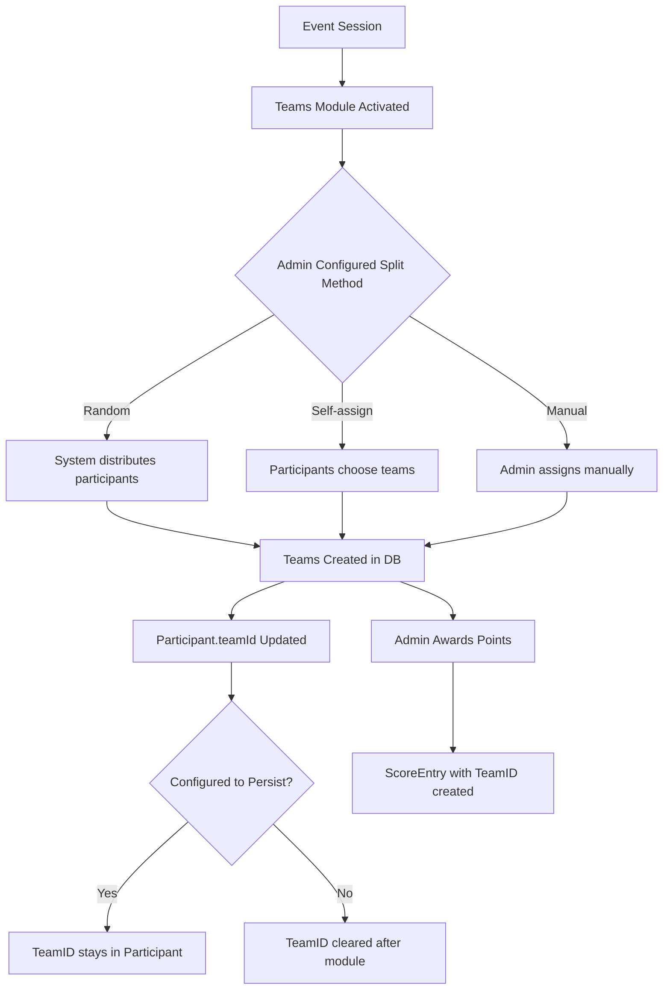

# Teams Module Implementation Plan

## Overview

This document describes the implementation plan for a Teams Module in the event system. The module enables admins to split participants into teams and award points to teams during events.

## Requirements Summary

1. **Team Splitting Methods** (configurable by admin):
   - Random - automatically distribute participants into N teams
   - Self-assign - participants choose their team
   - Manual - admin drag/drops participants into teams

2. **Point Awards**:
   - Admin manually awards points to teams via UI

3. **Persistence**:
   - Configurable: team assignments persist after module or reset

---

## Architecture

### Data Flow



---

## Implementation Steps

### Phase 1: Backend Data Models & API

#### 1.1 Add Team Module Type

**File**: `backend/models/event.go`

Add new module type constant:

```go
const (
    ModuleTypeForm          ModuleType = "form"
    ModuleTypeQuiz          ModuleType = "quiz"
    ModuleTypeWrongPictures ModuleType = "wrong_pictures"
    ModuleTypeTeams         ModuleType = "teams"  // NEW
)
```

#### 1.2 Define Teams Module Configuration

**File**: `backend/models/event.go`

Add Teams module configuration structure:

```go
type TeamsModuleConfig struct {
    SplitMethod       string `json:"splitMethod" bson:"splitMethod"` // "random", "self_assign", "manual"
    NumberOfTeams     int    `json:"numberOfTeams" bson:"numberOfTeams"`
    TeamNames         []string `json:"teamNames" bson:"teamNames"`
    TeamColors        []string `json:"teamColors" bson:"teamColors"`
    PersistAfterModule bool   `json:"persistAfterModule" bson:"persistAfterModule"`
    AllowSelfAssign   bool   `json:"allowSelfAssign" bson:"allowSelfAssign"`
}
```

- `splitMethod`: How teams are formed
- `numberOfTeams`: Number of teams (for random split)
- `teamNames`: Custom team names (if empty, generate "Team 1", "Team 2", etc.)
- `teamColors`: Team colors for UI display
- `persistAfterModule`: Whether team assignments persist after module completes
- `allowSelfAssign`: Whether participants can self-assign (if self_assign method)

#### 1.3 Add Team Repository Methods

**File**: `backend/database/team_repository.go`

Add methods:

```go
func (r *TeamRepository) GetByEventSessionID(ctx context.Context, sessionID string) ([]models.Team, error)
func (r *TeamRepository) DeleteBySessionID(ctx context.Context, sessionID string) error
func (r *TeamRepository) AddMember(ctx context.Context, teamID, participantID string) error
func (r *TeamRepository) RemoveMember(ctx context.Context, teamID, participantID string) error
func (r *TeamRepository) BulkCreate(ctx context.Context, teams []*models.Team) error
```

#### 1.4 Add Participant Repository Methods

**File**: `backend/database/participant_repository.go`

Add method to update team assignment:

```go
func (r *ParticipantRepository) UpdateTeamID(ctx context.Context, participantID, teamID string) error
func (r *ParticipantRepository) BulkUpdateTeamID(ctx context.Context, participantIDs []string, teamID string) error
func (r *ParticipantRepository) ClearTeamID(ctx context.Context, eventID string) error
```

#### 1.5 Create Teams Module Handler

**File**: `backend/handlers/teams_module.go` (NEW)

Implement handlers:

- `GET /events/{id}/teams` - Get all teams for event session
- `POST /events/{id}/teams/split` - Execute team split based on config
- `POST /events/{id}/teams/assign` - Manual assignment (admin drags participants)
- `POST /events/{id}/teams/{teamId}/award` - Award points to a team
- `POST /events/{id}/teams/reset` - Reset team assignments

### Phase 2: Team Splitting Logic

#### 2.1 Random Split Algorithm

```go
func splitRandomly(participants []*models.Participant, numTeams int) map[int][]string {
    shuffled := make([]*models.Participant, len(participants))
    copy(shuffled, participants)
    rand.Shuffle(len(shuffled), func(i, j int) {
        shuffled[i], shuffled[j] = shuffled[j], shuffled[i]
    })
    
    result := make(map[int][]string)
    for i, p := range shuffled {
        teamIndex := i % numTeams
        result[teamIndex] = append(result[teamIndex], p.ID)
    }
    return result
}
```

#### 2.2 Self-Assign Flow

1. Module activates with team list available
2. Participants see team selection UI
3. Each participant selects a team (once only)
4. System updates Team.MemberParticipantIDs

#### 2.3 Manual Assignment Flow

1. Admin sees participant list and team list
2. Admin drags participants to teams
3. Save button commits all changes

### Phase 3: Point Awarding

#### 3.1 Award Points to Team

**Handler**: `POST /events/{id}/teams/{teamId}/award`

```go
func AwardTeamPoints(w http.ResponseWriter, r *http.Request) {
    // Parse request: { "points": 100, "reason": "Best presentation" }
    // Create ScoreEntry with TeamID set (not ParticipantID)
    // Return updated team score
}
```

#### 3.2 ScoreEntry for Teams

The existing `ScoreEntry` model already supports team scoring:

```go
type ScoreEntry struct {
    ID            string        `json:"id" bson:"_id"`
    EventID       string        `json:"eventId" bson:"eventId"`
    ParticipantID string        `json:"participantId,omitempty" bson:"participantId,omitempty"`
    TeamID        string        `json:"teamId,omitempty" bson:"teamId,omitempty"`  // Use this
    ModuleID      string        `json:"moduleId" bson:"moduleId"`
    Category      ScoreCategory `json:"category" bson:"category"`
    Points        float64       `json:"points" bson:"points"`
    Reason        string        `json:"reason,omitempty" bson:"reason,omitempty"`
    CreatedAt     time.Time     `json:"createdAt" bson:"createdAt"`
}
```

### Phase 4: Module Lifecycle Integration

#### 4.1 On Module Start

1. Check if teams already exist for session
2. If not, show "Teams not configured" state
3. If split method is "random", execute split immediately
4. If "self_assign" or "manual", wait for action

#### 4.2 On Module Complete

```go
func OnModuleComplete(module *models.Module, session *models.EventSession) {
    config := parseTeamsConfig(module.Data)
    
    if !config.PersistAfterModule {
        // Clear TeamID from all participants
        participantRepo.ClearTeamID(ctx, session.EventID)
        // Optionally delete teams or mark as "inactive"
    }
}
```

### Phase 5: Frontend Implementation

#### 5.1 Add Teams Module Option

**File**: `frontend/src/views/AdminEventDetailsScreen.vue`

Add option to module type dropdown:

```vue
<option value="teams">{{ $t('admin.details.teams_option') }}</option>
```

#### 5.2 Create Teams Module Config Component

**File**: `frontend/src/components/TeamsModuleConfig.vue` (NEW)

Configuration UI:

- Split method dropdown (Random / Self-assign / Manual)
- Number of teams input (for random)
- Team names editor (comma-separated or per-row)
- Team colors picker
- Toggle: "Keep teams after module ends"
- Toggle: "Allow self-assign"

#### 5.3 Create Teams Module Player View

**File**: `frontend/src/components/modules/TeamsModule.vue` (NEW)

For participants:

- If random split: Show "You have been assigned to [Team Name]" with team color
- If self-assign: Show team selection buttons
- If manual: Show "Waiting for team assignment"

#### 5.4 Create Teams Admin Control Panel

**File**: `frontend/src/views/TeamsAdminPanel.vue` (NEW)

For admin during event:

- **Team List View**: Cards showing each team with member count
- **Member View**: Table of participants with team assignment dropdown
- **Points Panel**: Per-team points input + reason field + "Award" button
- **Team Score Display**: Real-time team scores (sum of all ScoreEntries with TeamID)
- **Actions**: 
  - "Split Randomly" button
  - "Reset Teams" button

---

## API Endpoints Summary

| Method | Endpoint | Description |
|--------|----------|-------------|
| GET | `/events/:id/teams` | Get all teams with members and scores |
| POST | `/events/:id/teams/split` | Execute random team split |
| POST | `/events/:id/teams/assign` | Assign participant to team (manual) |
| POST | `/events/:id/teams/:teamId/award` | Award points to team |
| DELETE | `/events/:id/teams/:teamId/member/:participantId` | Remove member from team |
| POST | `/events/:id/teams/reset` | Reset all team assignments |
| GET | `/events/:id/teams/leaderboard` | Get team rankings by score |

---

## Database Collections

### teams (existing)
```json
{
  "_id": "team_001",
  "eventSessionId": "session_001",
  "name": "Team Alpha",
  "color": "#FF5733",
  "memberParticipantIds": ["p1", "p2", "p3"],
  "metadata": {}
}
```

### event_participants (updated)
Existing field `teamId` will be populated:

```json
{
  "_id": "p1",
  "eventId": "event_001",
  "teamId": "team_001",  // Set by teams module
  "displayName": "John",
  ...
}
```

### score_entries (existing)
Team scores use TeamID:

```json
{
  "_id": "se_001",
  "eventId": "event_001",
  "teamId": "team_001",
  "moduleId": "module_teams",
  "points": 100,
  "reason": "Best team presentation",
  "createdAt": "2024-01-15T10:00:00Z"
}
```

---

## Localization Keys

Add to `frontend/src/locales/{en,ro,ru}.json`:

```json
{
  "admin": {
    "details": {
      "teams_option": "Teams",
      "teams_config": {
        "split_method": "Team Split Method",
        "random": "Random",
        "self_assign": "Self-assign",
        "manual": "Manual",
        "number_of_teams": "Number of Teams",
        "team_names": "Team Names",
        "team_colors": "Team Colors",
        "persist_after_module": "Keep teams after module ends",
        "allow_self_assign": "Allow participants to choose team"
      }
    }
  },
  "teams": {
    "assigned_to": "You are on team",
    "choose_team": "Choose your team",
    "waiting_assignment": "Waiting for team assignment...",
    "award_points": "Award Points",
    "points": "Points",
    "reason": "Reason"
  }
}
```

---

## Testing Checklist

- [ ] Create event with Teams module
- [ ] Configure random split - verify participants distributed
- [ ] Configure self-assign - verify participants can choose teams
- [ ] Configure manual - verify admin can drag/drop
- [ ] Award points to team - verify ScoreEntry created with TeamID
- [ ] Check team leaderboard shows correct totals
- [ ] Verify persist=false clears team assignments after module
- [ ] Verify persist=true keeps team assignments after module
- [ ] Test participant reconnection - team assignment persists correctly

---

## Implementation Order

1. Backend: Add module type constant + config struct
2. Backend: Extend team repository with needed methods
3. Backend: Extend participant repository
4. Backend: Create teams API handlers
5. Backend: Implement team split logic
6. Backend: Implement point award logic
7. Frontend: Add teams option to module dropdown
8. Frontend: Create TeamsModuleConfig component
9. Frontend: Create TeamsModule player view
10. Frontend: Create TeamsAdminPanel for live control
11. Testing: Integration testing
