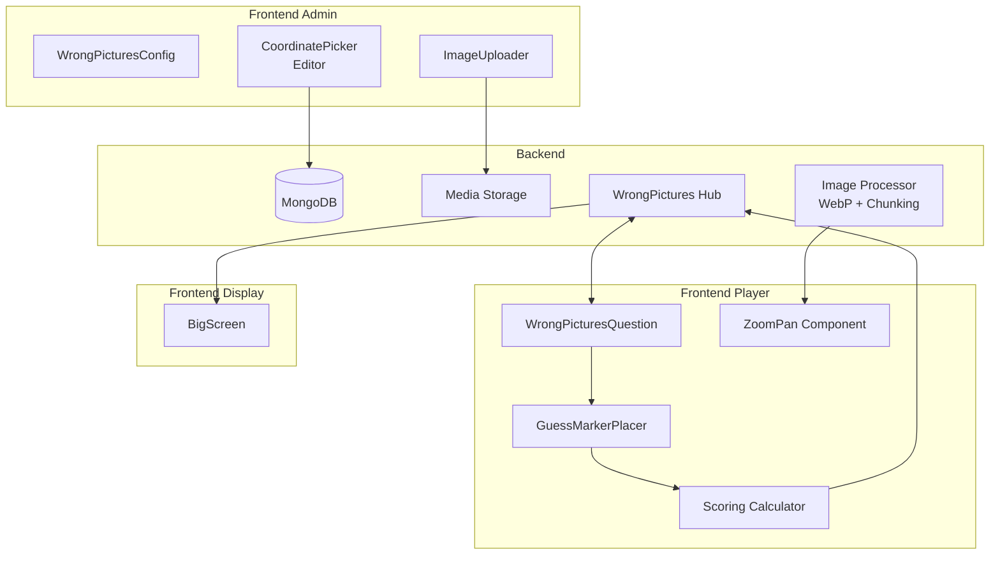

# Wrong Pictures Module - Implementation Plan

## Overview

This plan outlines the implementation of a new module called **"Wrong Pictures"** (similar to "Spot the Error" or "Find the Anomaly"). This is a visual trivia module where:

- Admin uploads pre-modified images (e.g., ancient Roman painting with modern sneakers added via Photoshop)
- Admin sets coordinates for each modification location (for auto-checking)
- Players see only the modified image and must place guess markers on the anomalies
- Multiple modifications per image are supported
- Scoring is calculated client-side based on distance from correct coordinates

---

## Key Requirements Summary

| Aspect | Requirement |
|--------|-------------|
| Module Type | Standalone quiz-like module (not question type) |
| Image Source | Admin uploads pre-modified images (external editing required) |
| Coordinate Setting | Admin clicks on image to set modification locations |
| Image Delivery | WebP format for size, original resolution preserved |
| Preloading | Chunked background preload while players answer |
| Player UI | Zoom/pan capability (pinch-to-zoom, drag to pan) |
| Guess Input | Draggable circular markers placed on image |
| Scoring | Client-side distance calculation, results sent to server |

---

## Architecture Diagram



---

## Phase 1: Backend Data Models

### 1.1 New Question Types

**File:** [`backend/models/quiz.go`](backend/models/quiz.go)

```go
// Add new question type constant
const (
    QuestionTypeWrongPictures = "wrong_pictures"
)

// WrongPictureTarget represents a modification location on an image
type WrongPictureTarget struct {
    ID          string  `json:"id" bson:"id"`                    // Unique target ID
    Label       string  `json:"label" bson:"label"`              // Description (e.g., "Modern sneakers")
    XPercent    float64 `json:"xPercent" bson:"xPercent"`        // X position as percentage (0-100)
    YPercent    float64 `json:"yPercent" bson:"yPercent"`        // Y position as percentage (0-100)
    Radius      float64 `json:"radius" bson:"radius"`            // Hit radius as percentage
}

// WrongPictureConfig stores wrong_pictures specific configuration
type WrongPictureConfig struct {
    Targets           []WrongPictureTarget `json:"targets" bson:"targets"`
    TolerancePercent float64              `json:"tolerancePercent" bson:"tolerancePercent"` // For scoring
    MaxPoints         int                  `json:"maxPoints" bson:"maxPoints"`
}

// Update QuizQuestion struct
type QuizQuestion struct {
    // ... existing fields ...
    WrongPictureConfig *WrongPictureConfig `json:"wrongPictureConfig" bson:"wrongPictureConfig"`
}
```

### 1.2 Player Signal for Wrong Pictures

**File:** [`backend/models/quiz.go`](backend/models/quiz.go)

```go
// PlayerGuess represents a player's guess marker
type PlayerGuess struct {
    TargetID   string  `json:"targetId" bson:"targetId"`     // Which target they're guessing
    XPercent   float64 `json:"xPercent" bson:"xPercent"`     // X position as percentage
    YPercent   float64 `json:"yPercent" bson:"yPercent"`     // Y position as percentage
    Distance   float64 `json:"distance" bson:"distance"`      // Distance from actual (calculated client-side)
    IsCorrect  bool    `json:"isCorrect" bson:"isCorrect"`   // Whether within tolerance
}

// Update PlayerSignal
type PlayerSignal struct {
    // ... existing fields ...
    Guesses []PlayerGuess `json:"guesses" bson:"guesses"` // For wrong_pictures type
}
```

---

## Phase 2: Backend Image Handling

### 2.1 WebP Conversion with Resolution Preservation

**File:** [`backend/utils/image.go`](backend/utils/image.go)

Add new function for WebP conversion:

```go
// ConvertToWebPWithMetadata converts image to WebP while preserving original dimensions
func ConvertToWebPWithMetadata(inputPath string, outputPath string, quality int) (width, height int, err error) {
    // Use standard library or vips for conversion
    // Preserve original dimensions in metadata
    // Return original width/height for coordinate mapping
}

// GenerateThumbnail creates smaller preview version
func GenerateThumbnail(inputPath string, outputPath string, maxSize int) error
```

### 2.2 Chunked Image Delivery

**File:** [`backend/handlers/media.go`](backend/handlers/media.go)

Add endpoint for chunked image delivery:

```go
// GET /media/{id}/chunked
// Returns image in chunks for progressive loading
// Headers: Range: bytes=0-1024000

// GET /media/{id}/webp
// Returns WebP version of image

// GET /media/{id}/info
// Returns image metadata (original width, height, etc.)
```

### 2.3 Image Preload Endpoint

**File:** [`backend/handlers/wrong_pictures.go`](backend/handlers/wrong_pictures.go) (new file)

```go
// GET /events/{eventId}/modules/{moduleId}/wrongpictures/preload
// Returns list of all image URLs for preload with metadata
type PreloadResponse struct {
    Questions []PreloadQuestion `json:"questions"`
}

type PreloadQuestion struct {
    Index     int         `json:"index"`
    ImageURL  string      `json:"imageUrl"`
    ThumbURL  string      `json:"thumbUrl"`
    Width     int         `json:"width"`
    Height    int         `json:"height"`
}
```

---

## Phase 3: Frontend Admin - Question Configuration

### 3.1 New Question Type in Editor

**File:** [`frontend/src/components/QuizQuestionEditor.vue`](frontend/src/components/QuizQuestionEditor.vue)

Add "wrong_pictures" option to question type dropdown:

```vue
<option value="wrong_pictures">{{ $t('quiz_config.question_editor.types.wrong_pictures') }}</option>
```

### 3.2 Coordinate Picker Component

**File:** [`frontend/src/components/CoordinatePicker.vue`](frontend/src/components/CoordinatePicker.vue) (new)

This component allows admin to click on image to set modification coordinates:

```vue
<template>
  <div class="coordinate-picker">
    <div 
      class="image-container" 
      @click="handleImageClick"
      ref="imageContainer"
    >
      
      
      <!-- Existing targets shown as markers -->
      <div 
        v-for="target in targets" 
        :key="target.id"
        class="target-marker"
        :style="getTargetStyle(target)"
        @click.stop="selectTarget(target)"
      >
        <span class="target-label">{{ target.label }}</span>
      </div>
      
      <!-- Currently placing marker -->
      <div 
        v-if="isPlacing" 
        class="placing-marker"
        :style="placingStyle"
      ></div>
    </div>
    
    <!-- Target list -->
    <div class="targets-list">
      <div v-for="target in targets" :key="target.id" class="target-item">
        <input v-model="target.label" @input="emitUpdate" />
        <button @click="removeTarget(target.id)">✕</button>
      </div>
      <button @click="startPlacing">+ Add Target</button>
    </div>
  </div>
</template>
```

Features:
- Click on image to add new target location
- Drag to adjust target position
- Edit target labels
- Delete targets
- Show targets as numbered circles on image

### 3.3 Updated Question Editor Section

**File:** [`frontend/src/components/QuizQuestionEditor.vue`](frontend/src/components/QuizQuestionEditor.vue)

Add new section for wrong_pictures type:

```vue
<!-- Wrong Pictures Configuration -->
<div v-if="localQuestion.type === 'wrong_pictures'" class="wrong-pictures-config">
  <div class="config-row">
    <label>{{ $t('quiz_config.question_editor.max_points') }}</label>
    <input 
      type="number" 
      v-model.number="localQuestion.wrongPictureConfig.maxPoints" 
      @input="emitUpdate"
    />
  </div>
  
  <div class="config-row">
    <label>{{ $t('quiz_config.question_editor.tolerance') }} (%)</label>
    <input 
      type="number" 
      v-model.number="localQuestion.wrongPictureConfig.tolerancePercent"
      @input="emitUpdate"
    />
  </div>
  
  <CoordinatePicker
    :image-url="imageUrl"
    :targets="localQuestion.wrongPictureConfig.targets"
    @update:targets="updateTargets"
  />
</div>
```

---

## Phase 4: Frontend Player - Question Display

### 4.1 Zoom/Pan Component

**File:** [`frontend/src/components/ZoomPanImage.vue`](frontend/src/components/ZoomPanImage.vue) (new)

Using standard web APIs (no external library needed):

```vue
<template>
  <div 
    class="zoom-pan-container"
    ref="container"
    @touchstart="handleTouchStart"
    @touchmove="handleTouchMove"
    @touchend="handleTouchEnd"
    @wheel="handleWheel"
  >
    <div 
      class="transform-wrapper"
      :style="transformStyle"
    >
      <slot></slot>
    </div>
  </div>
</template>

<script>
export default {
  data() {
    return {
      scale: 1,
      translateX: 0,
      translateY: 0,
      initialDistance: 0,
      initialScale: 1,
    };
  },
  computed: {
    transformStyle() {
      return {
        transform: `translate(${this.translateX}px, ${this.translateY}px) scale(${this.scale})`,
        transformOrigin: 'center center'
      };
    }
  },
  methods: {
    // Pinch to zoom
    handleTouchStart(e) {
      if (e.touches.length === 2) {
        this.initialDistance = this.getDistance(e.touches);
        this.initialScale = this.scale;
      }
    },
    handleTouchMove(e) {
      if (e.touches.length === 2) {
        const newDistance = this.getDistance(e.touches);
        const scale = (newDistance / this.initialDistance) * this.initialScale;
        this.scale = Math.min(Math.max(scale, 1), 4); // Max 4x zoom
      }
    },
    // Mouse wheel zoom
    handleWheel(e) {
      e.preventDefault();
      const delta = e.deltaY > 0 ? 0.9 : 1.1;
      this.scale = Math.min(Math.max(this.scale * delta, 1), 4);
    },
    getDistance(touches) {
      const dx = touches[0].clientX - touches[1].clientX;
      const dy = touches[0].clientY - touches[1].clientY;
      return Math.sqrt(dx * dx + dy * dy);
    }
  }
};
</script>
```

### 4.2 Guess Marker Component

**File:** [`frontend/src/components/GuessMarker.vue`](frontend/src/components/GuessMarker.vue) (new)

```vue
<template>
  <div 
    class="guess-marker"
    :class="{ placed: isPlaced, correct: isCorrect }"
    :style="markerStyle"
    @mousedown="startDrag"
    @touchstart="startDrag"
  >
    <div class="marker-circle">
      <span class="marker-number">{{ markerNumber }}</span>
    </div>
  </div>
</template>

<script>
export default {
  props: {
    markerNumber: { type: Number, required: true },
    xPercent: { type: Number, default: 0 },
    yPercent: { type: Number, default: 0 },
    isPlaced: { type: Boolean, default: false },
    isCorrect: { type: Boolean, default: false },
  },
  emits: ['update:position', 'placed'],
  data() {
    return {
      isDragging: false,
      dragOffsetX: 0,
      dragOffsetY: 0,
    };
  },
  computed: {
    markerStyle() {
      return {
        left: `${this.xPercent}%`,
        top: `${this.yPercent}%`,
      };
    }
  },
  methods: {
    startDrag(e) {
      e.preventDefault();
      this.isDragging = true;
      // Calculate offset from marker center
    },
    // Handle drag movement
    // Emit position updates
  }
};
</script>
```

### 4.3 Wrong Pictures Question View

**File:** [`frontend/src/views/QuizPlayerScreen.vue`](frontend/src/views/QuizPlayerScreen.vue)

Add new section for wrong_pictures question type:

```vue
<!-- Wrong Pictures Question -->
<div 
  v-else-if="state === States.QUESTION_ACTIVE && isWrongPictures" 
  class="state-container wrong-pictures-container"
>
  <div class="question-header">
    <div class="question-number-badge">{{ currentQuestionIndex + 1 }}</div>
    <h2 class="question-text">{{ currentQuestion?.text }}</h2>
    <div class="timer-bar">
      <div class="timer-progress" :style="{ width: (timeRemaining / (currentQuestion?.timeLimit || 30)) * 100 + '%' }"></div>
    </div>
  </div>
  
  <!-- Zoom/Pan Image Area -->
  <div class="image-area">
    <ZoomPanImage ref="zoomPan">
      <div class="image-wrapper" @click="handleImageClick">
        
        
        <!-- Guess markers -->
        <GuessMarker
          v-for="(guess, idx) in playerGuesses"
          :key="idx"
          :marker-number="idx + 1"
          :x-percent="guess.xPercent"
          :y-percent="guess.yPercent"
          :is-placed="true"
          @update:position="updateGuessPosition(idx, $event)"
        />
      </div>
    </ZoomPanImage>
  </div>
  
  <!-- Controls -->
  <div class="controls-area">
    <div class="marker-controls">
      <button 
        v-for="n in targetCount" 
        :key="n"
        class="marker-btn"
        :class="{ active: activeMarkerIndex === n - 1, placed: playerGuesses[n-1]?.isPlaced }"
        @click="selectMarker(n - 1)"
      >
        {{ n }}
      </button>
    </div>
    
    <button 
      class="submit-btn"
      :disabled="!canSubmit || hasSubmitted"
      @click="submitGuesses"
    >
      {{ hasSubmitted ? '✓' : $t('quiz.player.submit_btn') }}
    </button>
  </div>
  
  <!-- Instructions -->
  <div class="instructions">
    {{ $t('quiz.player.wrong_pictures.instructions') }}
  </div>
</div>
```

### 4.4 Client-Side Scoring

**File:** [`frontend/src/utils/wrongPicturesScoring.js`](frontend/src/utils/wrongPicturesScoring.js) (new)

```javascript
// Calculate distance between two percentage-based coordinates
export function calculateDistance(x1, y1, x2, y2) {
  return Math.sqrt(Math.pow(x2 - x1, 2) + Math.pow(y2 - y1, 2));
}

// Calculate score based on distance from target
export function calculateGuessScore(guess, target, tolerancePercent, maxPoints) {
  const distance = calculateDistance(
    guess.xPercent, 
    guess.yPercent, 
    target.xPercent, 
    target.yPercent
  );
  
  if (distance <= target.radius + tolerancePercent) {
    // Within tolerance - calculate partial score based on distance
    const maxDistance = target.radius + tolerancePercent;
    const accuracy = 1 - (distance / maxDistance);
    return Math.round(maxPoints * accuracy);
  }
  
  return 0;
}

// Calculate total score for all guesses
export function calculateTotalScore(guesses, targets, config) {
  let totalScore = 0;
  const scoredGuesses = [];
  
  // Match each guess to nearest unmatched target
  const usedTargets = new Set();
  
  for (const guess of guesses) {
    let bestMatch = null;
    let bestDistance = Infinity;
    
    for (const target of targets) {
      if (usedTargets.has(target.id)) continue;
      
      const distance = calculateDistance(
        guess.xPercent,
        guess.yPercent,
        target.xPercent,
        target.yPercent
      );
      
      if (distance < bestDistance) {
        bestDistance = distance;
        bestMatch = target;
      }
    }
    
    if (bestMatch) {
      usedTargets.add(bestMatch.id);
      const score = calculateGuessScore(
        guess,
        bestMatch,
        config.tolerancePercent,
        config.maxPoints / targets.length
      );
      totalScore += score;
      
      scoredGuesses.push({
        ...guess,
        targetId: bestMatch.id,
        distance: bestDistance,
        isCorrect: score > 0,
        scoreEarned: score
      });
    }
  }
  
  return { totalScore, scoredGuesses };
}
```

---

## Phase 5: Image Preloading System

### 5.1 Preload Manager

**File:** [`frontend/src/utils/imagePreload.js`](frontend/src/utils/imagePreload.js) (new)

```javascript
// Chunked image preloader
export class ImagePreloadManager {
  constructor() {
    this.preloadedImages = new Map();
    this.loadingQueue = [];
    this.currentLoading = 0;
    this.maxConcurrent = 3;
  }
  
  // Preload images in chunks
  async preloadQuestions(questions, onProgress) {
    const total = questions.length;
    let loaded = 0;
    
    for (let i = 0; i < total; i++) {
      const question = questions[i];
      
      // Load first question immediately
      if (i === 0) {
        await this.loadImage(question.imageUrl);
        loaded++;
        onProgress?.(loaded / total);
        continue;
      }
      
      // Background load remaining questions
      this.loadInBackground(question.imageUrl).then(() => {
        loaded++;
        onProgress?.(loaded / total);
      });
    }
  }
  
  async loadImage(url) {
    return new Promise((resolve, reject) => {
      const img = new Image();
      img.onload = () => {
        this.preloadedImages.set(url, img);
        resolve(img);
      };
      img.onerror = reject;
      img.src = url;
    });
  }
  
  async loadInBackground(url) {
    if (this.preloadedImages.has(url)) {
      return this.preloadedImages.get(url);
    }
    
    // Wait for available slot
    while (this.currentLoading >= this.maxConcurrent) {
      await new Promise(r => setTimeout(r, 100));
    }
    
    this.currentLoading++;
    try {
      return await this.loadImage(url);
    } finally {
      this.currentLoading--;
    }
  }
  
  getImage(url) {
    return this.preloadedImages.get(url);
  }
}
```

---

## Phase 6: BigScreen Display

### 6.1 Wrong Pictures Display

**File:** [`frontend/src/views/BigScreen.vue`](frontend/src/views/BigScreen.vue)

Add display logic for wrong_pictures questions:

```vue
<!-- Wrong Pictures Question Display -->
<div v-if="isWrongPicturesQuestion" class="bigscreen-wrong-pictures">
  <div class="question-display">
    <h1>{{ currentQuestion?.text }}</h1>
  </div>
  
  <div class="image-display">
    
  </div>
  
  <!-- Show correct answers after time expires -->
  <div v-if="showResults" class="answers-overlay">
    <div 
      v-for="target in currentQuestion?.wrongPictureConfig?.targets"
      :key="target.id"
      class="correct-marker"
      :style="getTargetStyle(target)"
    >
      <span>{{ target.label }}</span>
    </div>
  </div>
  
  <!-- Player answer stats -->
  <div v-if="showResults" class="results-stats">
    <div class="stat-item">
      <span class="stat-value">{{ correctCount }}</span>
      <span class="stat-label">Found</span>
    </div>
  </div>
</div>
```

---

## Phase 7: Localization

### 7.1 Add Translation Keys

**File:** [`frontend/src/locales/en.json`](frontend/src/locales/en.json)

```json
{
  "quiz_config": {
    "question_editor": {
      "types": {
        "wrong_pictures": "Wrong Pictures"
      },
      "wrong_pictures": {
        "add_target": "Add Target",
        "target_label": "Target Label",
        "target_position": "Position",
        "max_points": "Max Points",
        "tolerance": "Tolerance (%)",
        "instructions": "Click on the image to mark what's wrong"
      }
    }
  },
  "quiz": {
    "player": {
      "wrong_pictures": {
        "instructions": "Find and tap on all the wrong items in the picture",
        "place_marker": "Tap to place marker",
        "found": "Found!",
        "not_found": "Not found"
      }
    }
  }
}
```

Add similar entries for `ro.json` and `ru.json`.

---

## Phase 8: Integration Points

### 8.1 Quiz Hub Integration

**File:** [`backend/hub/quiz_hub.go`](backend/hub/quiz_hub.go)

The existing quiz hub already handles question batching and player signals. For wrong_pictures:

1. Add new signal processing for guesses array
2. Update scoring calculation to handle array of guesses
3. Add new result display mode

### 8.2 Router Integration

**File:** [`frontend/src/router/index.js`](frontend/src/router/index.js)

No new routes needed - uses existing quiz routes.

---

## Implementation Order

1. **Backend Models** - Add data structures
2. **Image Handling** - WebP conversion and chunked delivery
3. **Admin UI** - Coordinate picker component
4. **Player UI** - Zoom/pan and guess marker components
5. **Scoring** - Client-side calculation
6. **Preloading** - Image preload manager
7. **BigScreen** - Display integration
8. **Localization** - Translation keys

---

## File Summary

### New Files to Create

| File | Purpose |
|------|---------|
| `backend/handlers/wrong_pictures.go` | API endpoints for wrong pictures |
| `backend/utils/image.go` (update) | WebP conversion utilities |
| `frontend/src/components/CoordinatePicker.vue` | Admin coordinate editor |
| `frontend/src/components/ZoomPanImage.vue` | Zoom/pan wrapper |
| `frontend/src/components/GuessMarker.vue` | Draggable guess marker |
| `frontend/src/utils/wrongPicturesScoring.js` | Client-side scoring |
| `frontend/src/utils/imagePreload.js` | Chunked preloader |

### Files to Modify

| File | Changes |
|------|---------|
| `backend/models/quiz.go` | Add new question type, structures |
| `backend/handlers/media.go` | Add WebP and chunked endpoints |
| `backend/hub/quiz_hub.go` | Handle wrong_pictures signals |
| `frontend/src/components/QuizQuestionEditor.vue` | Add wrong_pictures UI |
| `frontend/src/views/QuizPlayerScreen.vue` | Add player interaction |
| `frontend/src/views/BigScreen.vue` | Add display mode |
| `frontend/src/locales/en.json` | Add translations |
| `frontend/src/locales/ro.json` | Add translations |
| `frontend/src/locales/ru.json` | Add translations |

---

## Next Steps

1. Approve this plan
2. Begin implementation starting with backend models
3. Progress through phases sequentially
4. Test each component before moving to next phase
